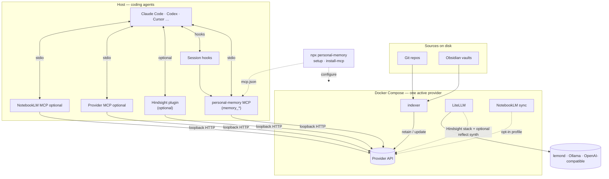

# personal-memory

[](https://www.npmjs.com/package/personal-memory)

**npm:** [personal-memory](https://www.npmjs.com/package/personal-memory) · **Docs:** [bcmyguest.github.io/personal-memory](https://bcmyguest.github.io/personal-memory/)

**Pick your memory backend** — Hindsight, mem0, or Cognee (all supported today), or the next manifest. One wizard and indexer on your machine; switch with `npx personal-memory switch`. Architecture: [docs/architecture.md](docs/architecture.md) · contributors: [memory providers](docs/memory-providers.md).

## Quickstart

| Step | Command |
| --- | --- |
| 1. Wizard | `npx personal-memory` |
| 2. Check | `npx personal-memory doctor` |
| 3. MCP (optional) | `npx personal-memory install-mcp --yes` |

**Checkout instead of npx:**

```sh
git clone https://github.com/bcmyguest/personal-memory.git && cd personal-memory
npm install && npx . setup
```

**Needs:** Docker Compose v2, Node ≥ 20.12, and an LLM route if you use Hindsight (lemond, Ollama, or OpenAI-compatible — set in the wizard).

### Day-2

```sh
npx personal-memory up
npx personal-memory down
npx personal-memory switch mem0 --yes
npx personal-memory doctor
```

Wizard dry-run (what first setup plans — no writes):


Full guide: [docs/quickstart.md](docs/quickstart.md) · [docs site](https://bcmyguest.github.io/personal-memory/docs/getting-started/)

## Architecture



| Connection | What it is |
| --- | --- |
| Sources → indexer → provider | Shared watcher; sink from active manifest (`MEMORY_SINK`) |
| Agents → MCP / plugin → provider | `install-mcp` adds unified **`personal-memory`** MCP; Hindsight session memory uses the coding-agent **plugin** |
| Wizard (dashed) | Writes env, starts compose, registers MCP — not on the hot indexing path |

Default Hindsight compose: `litellm`, `hindsight` (`127.0.0.1:8888`), `indexer`. mem0/Cognee stacks omit LiteLLM unless you add them separately.

Full detail: [docs/architecture.md](docs/architecture.md).

## Documentation

| Topic | File |
| --- | --- |
| Quickstart | [docs/quickstart.md](docs/quickstart.md) |
| Setup wizard | [docs/setup-wizard.md](docs/setup-wizard.md) |
| npx install, stack root | [docs/npx-install.md](docs/npx-install.md) |
| `config.toml` | [docs/personal-memory-config.md](docs/personal-memory-config.md) |
| Manual compose | [docs/manual-stack-setup.md](docs/manual-stack-setup.md) |
| Models (LiteLLM) | [docs/model-configuration.md](docs/model-configuration.md) |
| Indexing | [docs/indexing.md](docs/indexing.md) |
| NotebookLM | [docs/notebooklm.md](docs/notebooklm.md) |
| Coding agents / MCP | [docs/coding-agents.md](docs/coding-agents.md) |

## Logs and reset

```sh
npx personal-memory down
docker compose down -v   # from stack root: delete the memory database volume
docker compose logs -f indexer hindsight
```
