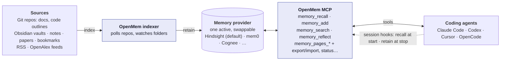

# OpenMem

> [!NOTE]
> **Context management moved to [Smarter Compact](https://github.com/bcmyguest/smarter-compact).** OpenMem 0.10 removed its context proxy, session store, `smart_compact_*` tools and OpenCode 2 trim. OpenMem covers **memory**: providers, the indexer, `memory_*` MCP tools and coding-agent hooks. For trimming long sessions, install Smarter Compact ([docs](https://bcmyguest.github.io/smarter-compact/)).

**OpenMem.** Pluggable [memory providers](https://bcmyguest.github.io/openmem/docs/provider-status/) (Hindsight, mem0, Cognee) and one setup wizard for coding-agent memory — retain, recall, and index your sources.

Your sources become memory any agent can query.

<picture>
<source media="(prefers-color-scheme: dark)" srcset="https://bcmyguest.github.io/openmem/media/overview-memory-wide-dark.png" />

</picture>

**Docs:** [bcmyguest.github.io/openmem/](https://bcmyguest.github.io/openmem/)

**MCP:** `npx -y -p @bcmyguest/openmem openmem-mcp` (after the wizard — it needs a running provider)

**Start here:** [Concepts](https://bcmyguest.github.io/openmem/docs/concepts/) · [Quickstart](https://bcmyguest.github.io/openmem/docs/getting-started/) · [Compatibility](https://bcmyguest.github.io/openmem/docs/compatibility/) · [Development](docs/development.md) (clone, tests, prek)

## Quickstart

| Step | Command |
| --- | --- |
| 1. Wizard | `npx @bcmyguest/openmem setup` |
| 2. Check | `npx @bcmyguest/openmem doctor` |
| 3. Coding agents | `npx @bcmyguest/openmem install-coding-agent --yes` |

**From a git clone:** [Development guide](docs/development.md) (`npm install`, `npm run setup`, tests, prek).

**Needs (wizard):** Docker Compose v2, Node ≥ 24, and an LLM route for Hindsight — see [Quickstart](https://bcmyguest.github.io/openmem/docs/getting-started/).

Later: `npx @bcmyguest/openmem up` / `down` / `switch <provider> --yes` / `doctor`.

Wizard dry-run (what first setup plans — no writes):

Full guide: [Quickstart](https://bcmyguest.github.io/openmem/docs/getting-started/) · [Concepts](https://bcmyguest.github.io/openmem/docs/concepts/) · [Architecture](https://bcmyguest.github.io/openmem/docs/architecture/)

## Architecture

The diagram at the top shows the memory flow.

Same diagram as Mermaid

See [architecture](https://bcmyguest.github.io/openmem/docs/architecture/) for memory runtime paths and provider-specific behavior.

## Providers and portability

- **Providers** — [Provider status](https://bcmyguest.github.io/openmem/docs/provider-status/) lists every provider and its support level from the manifests. Contributor details: [adding a provider](https://github.com/bcmyguest/openmem/blob/main/docs/memory-providers.md).
- **MCP** — unified `memory_*` plus optional native/NotebookLM servers: [MCP setup](https://bcmyguest.github.io/openmem/docs/mcp-setup/).
- **Portable memory** — `memory_export` / `memory_import` speak **PMM**: [Portable memory](https://bcmyguest.github.io/openmem/docs/memory-portability/).
- **Switch** — `npx @bcmyguest/openmem switch <provider>` does not migrate data by itself; export/import (or re-index) moves content.

Compose runs the shared `indexer` and the services required by the selected provider. Hindsight uses `litellm` and `hindsight` (`127.0.0.1:8888`); mem0 and Cognee use their own APIs and do not include LiteLLM by default. LiteLLM can also be added for `memory_reflect` synthesis on mem0/Cognee. See [Architecture](https://bcmyguest.github.io/openmem/docs/architecture/) for runtime paths.

## Inspiration and related

OpenMem is not affiliated with these projects; they shape the problem or the pattern.

| | |
| --- | --- |
| **[OpenFeature](https://openfeature.dev/)** | Inspiration for a vendor-agnostic interface + pluggable providers (there: feature flags; here: coding-agent memory). |
| **[mise](https://mise.jdx.dev/) / [asdf](https://asdf-vm.com/)** | One CLI over many backends; declarative config and tasks without replacing each tool’s own settings. |
| **[LiteLLM](https://github.com/BerriAI/litellm)** | Model proxy used on Hindsight stacks. |
| **[Hindsight coding agents](https://www.npmjs.com/package/@vectorize-io/hindsight-coding-agents)** | Reference implementation for knowledge pages, initiative capture and ingest status; OpenMem's hooks replace it in `openmem` mode. |
| **[rtk](https://github.com/rtk-ai/rtk)** | Compresses shell command output before the agent sees it; `install-coding-agent` runs `rtk init` when it is installed. |
| **[Meridian](https://github.com/rynfar/meridian)** | Bridges a Claude subscription to an Anthropic-compatible API; optional Hindsight model backend ([guide](https://bcmyguest.github.io/openmem/docs/model-configuration/)). |
| **[OpenCode](https://opencode.ai/)** / **[Claude Code hooks](https://code.claude.com/docs/en/hooks)** / **[Codex hooks](https://developers.openai.com/codex/hooks)** | The agent hook and plugin APIs OpenMem translates between ([compatibility](https://bcmyguest.github.io/openmem/docs/compatibility/)). |

More setup analogues: [Pluggable memory providers](https://github.com/bcmyguest/openmem/blob/main/docs/memory-providers.md).

> Formerly **personal-memory**. Use the `openmem` CLI and MCP server name; installers drop the old `personal-memory` MCP entry.

## References

Papers and preprints on agent memory ([full list](docs/references.md)):

| Reference | Link |
| --- | --- |
| MemGPT (Packer et al., 2023) | [arXiv:2310.08560](https://arxiv.org/abs/2310.08560) |
| LoCoMo (An et al., 2024) | [arXiv:2402.17753](https://arxiv.org/abs/2402.17753) |
| LongMemEval (Wu et al., 2024) | [arXiv:2410.10813](https://arxiv.org/abs/2410.10813) |
| MemoryAgentBench (2025) | [arXiv:2507.05257](https://arxiv.org/abs/2507.05257) |

Reports: [references.md](docs/references.md#related-reports-not-arxiv). Context-management references moved to [Smarter Compact](https://github.com/bcmyguest/smarter-compact).

## License

[Apache License 2.0](LICENSE) — see `LICENSE` (Copyright 2026 B Guest).

## Contributing

Contributions are welcome. See [CONTRIBUTING.md](CONTRIBUTING.md) and the [development guide](docs/development.md) for tests and CI.
