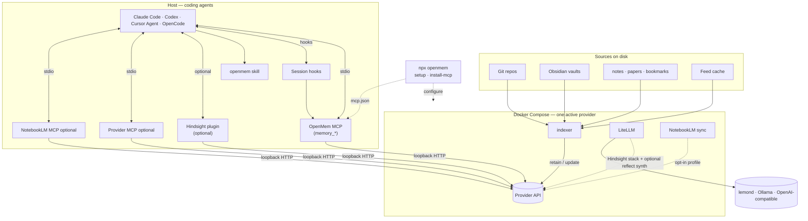

# OpenMem

[](https://www.npmjs.com/package/openmem)
[](LICENSE)
[](https://glama.ai/mcp/servers/@bcmyguest/openmem)
[](https://smithery.ai/server/@bcmyguest/openmem)
[](https://github.com/bcmyguest/openmem)

[](https://glama.ai/mcp/servers/@bcmyguest/openmem)

**npm:** [openmem](https://www.npmjs.com/package/openmem) · **MCP:** `npx -y openmem-mcp` · **Repo:** [github.com/bcmyguest/openmem](https://github.com/bcmyguest/openmem)

**OpenMem** is a **memory interface for coding agents**: a stable `memory_*` API and ops surface over pluggable backends (Hindsight, mem0, Cognee, …), with shared wizard, indexer, and import/export formats (PMM first).

> Formerly **personal-memory**. Use the `openmem` CLI and MCP server name; installers drop the old `personal-memory` MCP entry.

**Read first:** [Concepts](docs/concepts.md) · [docs site](https://bcmyguest.github.io/openmem/docs/concepts/)

## Quickstart

| Step | Command |
| --- | --- |
| 1. Wizard | `npx openmem` |
| 2. Check | `npx openmem doctor` |
| 3. Coding agents | `npx openmem install-coding-agent --yes` |

**Checkout instead of npx:**

```sh
git clone https://github.com/bcmyguest/openmem.git && cd openmem
npm install && npx . setup
```

**Needs:** Docker Compose v2, Node ≥ 20.12, and an LLM route if you use Hindsight (lemond, Ollama, or OpenAI-compatible — set in the wizard).

### Day-2

```sh
npx openmem up
npx openmem down
npx openmem switch mem0 --yes
npx openmem doctor
```

Wizard dry-run (what first setup plans — no writes):


Full guide: [docs/quickstart.md](docs/quickstart.md) · [docs site](https://bcmyguest.github.io/openmem/docs/getting-started/) · [rebrand notes](docs/OPENMEM.md)

## Architecture



| Connection | What it is |
| --- | --- |
| Sources → indexer → provider | Shared watcher; sink from active manifest (`MEMORY_SINK`) |
| Agents → MCP / hooks → provider | `install-coding-agent` installs the shared skill, unified `memory_*` MCP, and session hooks for Claude Code, Codex, Cursor Agent, and OpenCode |
| Wizard (dashed) | Writes env, starts compose, registers MCP — not on the hot indexing path |

On Hindsight stacks, `memory_reflect` uses Hindsight's native reflect API and returns its answer with source evidence. On mem0 and Cognee, it searches first and uses the configured LiteLLM route for synthesis when available; otherwise it returns the search hits. See [coding-agent hooks](docs/coding-agent-hooks.md) for the current limits.

## Providers and portability

- **Providers** — manifests under `providers/` (Hindsight, mem0, Cognee). Add another with a compose fragment, indexer sink, and wizard hooks.
- **Formats** — `memory_export` / `memory_import` speak **PMM** today; more interchange formats belong in the same portability layer.
- **Switch** — `npx openmem switch <provider>` does not migrate data by itself; export/import (or re-index) moves content.

Default Hindsight compose: `litellm`, `hindsight` (`127.0.0.1:8888`), `indexer`. mem0/Cognee stacks omit LiteLLM unless you add them separately.

## Inspiration and related

OpenMem is not affiliated with these projects; they shape the problem or the pattern.

| | |
| --- | --- |
| **[OpenFeature](https://openfeature.dev/)** | Inspiration for a vendor-agnostic interface + pluggable providers (there: feature flags; here: coding-agent memory). |
| **[mise](https://mise.jdx.dev/) / [asdf](https://asdf-vm.com/)** | One CLI over many backends; declarative config and tasks without replacing each tool’s own settings. |
| **[Hindsight](https://github.com/vectorize-io/hindsight)** | Default memory provider in this repo. |
| **[mem0](https://github.com/mem0ai/mem0)** | Supported memory provider. |
| **[Cognee](https://github.com/topoteretes/cognee)** | Supported memory provider. |
| **[LiteLLM](https://github.com/BerriAI/litellm)** | Model proxy used on Hindsight stacks. |

More setup analogues (Chezmoi, Home Assistant integrations, …): [docs/memory-providers.md](docs/memory-providers.md).

## License

[Apache License 2.0](LICENSE) — see `LICENSE` (Copyright 2026 B Guest).
