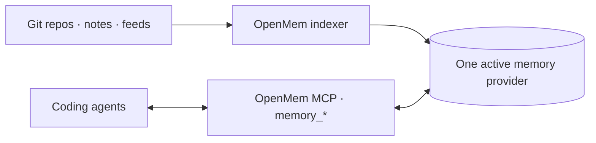

# OpenMem

[](https://www.npmjs.com/package/@bcmyguest/openmem)
[](LICENSE)
[](https://glama.ai/mcp/servers/bcmyguest/openmem/score)
[](https://github.com/bcmyguest/openmem)

[](https://glama.ai/mcp/servers/bcmyguest/openmem)

**Docs:** [bcmyguest.github.io/openmem/](https://bcmyguest.github.io/openmem/) 

**npm:** [@bcmyguest/openmem](https://www.npmjs.com/package/@bcmyguest/openmem) 

**MCP:** `npx -y -p @bcmyguest/openmem openmem-mcp` 

**Repo:** [github.com/bcmyguest/openmem](https://github.com/bcmyguest/openmem)

**OpenMem** is a **memory interface for coding agents**: a stable `memory_*` API over pluggable [memory providers](https://bcmyguest.github.io/openmem/docs/provider-status/), with a shared wizard, indexer, and import/export format (PMM first).

> Formerly **personal-memory**. Use the `openmem` CLI and MCP server name; installers drop the old `personal-memory` MCP entry.

**Start here:** [Concepts](https://bcmyguest.github.io/openmem/docs/concepts/) · [Quickstart](https://bcmyguest.github.io/openmem/docs/getting-started/)

## Quickstart

| Step | Command |
| --- | --- |
| 1. Wizard | `npx @bcmyguest/openmem` |
| 2. Check | `npx @bcmyguest/openmem doctor` |
| 3. Coding agents | `npx @bcmyguest/openmem install-coding-agent --yes` |

**Checkout instead of npx:**

```sh
git clone https://github.com/bcmyguest/openmem.git && cd openmem
npm install && npx . setup
```

**Needs:** Docker Compose v2, Node ≥ 20.12, and an LLM route if you use Hindsight (lemond, Ollama, or OpenAI-compatible — set in the wizard).

Later: `npx @bcmyguest/openmem up` / `down` / `switch <provider> --yes` / `doctor`.

Wizard dry-run (what first setup plans — no writes):


Full guide: [Quickstart](https://bcmyguest.github.io/openmem/docs/getting-started/) · [Concepts](https://bcmyguest.github.io/openmem/docs/concepts/) · [Architecture](https://bcmyguest.github.io/openmem/docs/architecture/)

## Architecture



The indexer and coding agents share one active memory provider. Session hooks use the same `memory_*` MCP. See the [full architecture](https://bcmyguest.github.io/openmem/docs/architecture/) for setup, optional integrations, and provider-specific behavior.

## Providers and portability

- **Providers** — [Provider status](https://bcmyguest.github.io/openmem/docs/provider-status/) lists every provider and its support level from the manifests. Contributor details: [adding a provider](https://github.com/bcmyguest/openmem/blob/main/docs/memory-providers.md).
- **MCP** — unified `memory_*` plus optional native/NotebookLM servers: [MCP setup](https://bcmyguest.github.io/openmem/docs/mcp-setup/).
- **Portable memory** — `memory_export` / `memory_import` speak **PMM**: [Portable memory](https://bcmyguest.github.io/openmem/docs/memory-portability/).
- **Switch** — `npx @bcmyguest/openmem switch <provider>` does not migrate data by itself; export/import (or re-index) moves content.

Default Hindsight compose: `litellm`, `hindsight` (`127.0.0.1:8888`), `indexer`. mem0/Cognee stacks omit LiteLLM unless you add them separately.

## Inspiration and related

OpenMem is not affiliated with these projects; they shape the problem or the pattern.

| | |
| --- | --- |
| **[OpenFeature](https://openfeature.dev/)** | Inspiration for a vendor-agnostic interface + pluggable providers (there: feature flags; here: coding-agent memory). |
| **[mise](https://mise.jdx.dev/) / [asdf](https://asdf-vm.com/)** | One CLI over many backends; declarative config and tasks without replacing each tool’s own settings. |
| **[LiteLLM](https://github.com/BerriAI/litellm)** | Model proxy used on Hindsight stacks. |

More setup analogues: [Pluggable memory providers](https://github.com/bcmyguest/openmem/blob/main/docs/memory-providers.md).

## License

[Apache License 2.0](LICENSE) — see `LICENSE` (Copyright 2026 B Guest).
