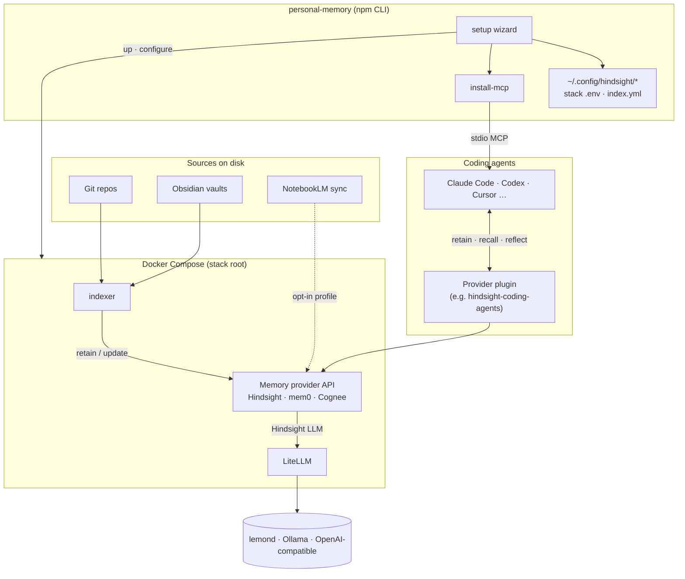

# personal-memory

**Docs site:** [bcmyguest.github.io/personal-memory](https://bcmyguest.github.io/personal-memory/)

Pluggable **local memory for coding agents**: one wizard and indexer, multiple provider backends (Docker Compose + HTTP sinks). **Hindsight** is supported today; **mem0** and **Cognee** are experimental ([memory providers](docs/memory-providers.md)).

## Architecture



| Connection | What it is |
| --- | --- |
| Wizard → stack | Picks provider, writes env, builds indexer image, starts compose, smoke test |
| Sources → indexer | Shared watcher; provider chosen via `MEMORY_SINK` / manifest |
| Indexer → provider | HTTP sink (`HINDSIGHT_URL` or `MEMORY_API_URL`) |
| Hindsight → LiteLLM → LLM | Retain/reflect/consolidate call local models through the proxy only |
| Agents → provider | Each provider’s **plugin** (Hindsight) and/or **MCP** entries merged by `install-mcp` |
| Provider plugins | `providers/<id>/manifest.json` + `wizard.mjs` hooks; not a replacement for native provider UIs |

## Hindsight stack (default)

| Service | Role |
| --- | --- |
| `litellm` | OpenAI-compatible proxy on the internal Docker network |
| `hindsight` | Memory API on `127.0.0.1:8888`, control plane on `127.0.0.1:9999` |
| `indexer` | Indexes sources into the active provider and keeps them current |

## Quick start

**Requirements:** Docker Compose v2, Node.js ≥ 20.12, a model backend for Hindsight (lemond, Ollama, or OpenAI-compatible).

```sh
npx personal-memory
# checkout: git clone https://github.com/bcmyguest/personal-memory.git && cd personal-memory && npm install && npx . setup
```

Day-2: `npx personal-memory up` · `down` · `doctor` · `install-mcp --yes` · `switch <provider> --yes`


Full walkthrough: [Getting started on the docs site](https://bcmyguest.github.io/personal-memory/docs/getting-started/).

## Documentation

| Topic | File |
| --- | --- |
| Setup wizard (phases, flags, paths) | [docs/setup-wizard.md](docs/setup-wizard.md) |
| npx install, stack root, upgrades | [docs/npx-install.md](docs/npx-install.md) |
| `config.toml` and CLI tasks | [docs/personal-memory-config.md](docs/personal-memory-config.md) |
| Manual compose / `setup.mjs` | [docs/manual-stack-setup.md](docs/manual-stack-setup.md) |
| LiteLLM routes and models | [docs/model-configuration.md](docs/model-configuration.md) |
| Indexer and `index.yml` | [docs/indexing.md](docs/indexing.md) |
| NotebookLM sync and MCP | [docs/notebooklm.md](docs/notebooklm.md) |
| Coding-agent plugin and MCP | [docs/coding-agents.md](docs/coding-agents.md) |
| Provider plugins | [docs/memory-providers.md](docs/memory-providers.md) |

Provider operator guides: `providers/mem0/OPERATOR.md`, `providers/cognee/OPERATOR.md`.

## Logs and reset

```sh
npx personal-memory down
docker compose down -v   # from stack root: delete the memory database volume
docker compose logs -f indexer hindsight
```
