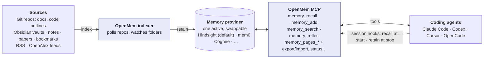
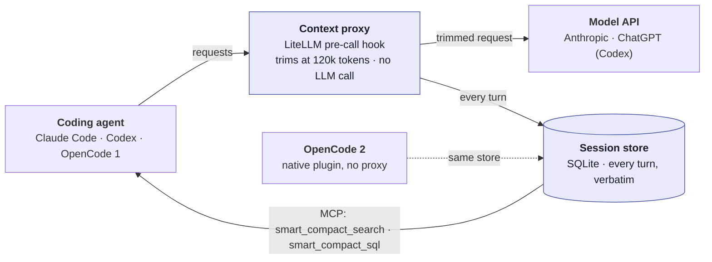

# OpenMem

[](https://www.npmjs.com/package/@bcmyguest/openmem)
[](LICENSE)
[](https://glama.ai/mcp/servers/bcmyguest/openmem/score)
[](https://github.com/bcmyguest/openmem)

[](https://glama.ai/mcp/servers/bcmyguest/openmem)

**OpenMem.** Memory and context management for coding agents: smart compaction that keeps every turn searchable, pluggable [memory providers](https://bcmyguest.github.io/openmem/docs/provider-status/) (Hindsight, mem0, Cognee), one setup wizard.

**A. Memory**: your sources become memory any agent can query.

<p align="center">
<picture>
<source media="(prefers-color-scheme: dark)" srcset="https://bcmyguest.github.io/openmem/media/overview-memory-wide-dark.png" />

</picture>
</p>

**B. Context management**: long sessions stay under the limit; nothing is summarized away.

<p align="center">
<picture>
<source media="(prefers-color-scheme: dark)" srcset="https://bcmyguest.github.io/openmem/media/overview-context-wide-dark.png" />

</picture>
</p>

**Benchmarks:** [smart compaction against Claude Code's native compaction and keep-everything](https://bcmyguest.github.io/openmem/docs/context-management/#benchmarks) on [ContextBench](https://github.com/RulinShao/ContextBench) synthetic tasks (Claude Haiku 5.5). Compact-Bench real-coding results are in progress.

<p align="center">
<picture>
<source media="(prefers-color-scheme: dark)" srcset="https://bcmyguest.github.io/openmem/media/contextbench-quality-compact-dark.png" />

</picture>
</p>

**Docs:** [bcmyguest.github.io/openmem/](https://bcmyguest.github.io/openmem/) 

**MCP:** `npx -y -p @bcmyguest/openmem openmem-mcp` (after the wizard — it needs a running provider)

**Start here:** [Concepts](https://bcmyguest.github.io/openmem/docs/concepts/) · [Quickstart](https://bcmyguest.github.io/openmem/docs/getting-started/) · [Compatibility](https://bcmyguest.github.io/openmem/docs/compatibility/)

## Quickstart

| Step | Command |
| --- | --- |
| 1. Wizard | `npx @bcmyguest/openmem` |
| 2. Check | `npx @bcmyguest/openmem doctor` |
| 3. Coding agents | `npx @bcmyguest/openmem install-coding-agent --yes` |

**Checkout instead of npx:**

```sh
git clone https://github.com/bcmyguest/openmem.git && cd openmem
npm install && npm run setup
```

Other commands from a checkout: `node cli/openmem.mjs <command>`.

**Needs:** Docker Compose v2, Node ≥ 24 (built-in `node:sqlite` with FTS5), and an LLM route if you use Hindsight (lemond, Ollama, OpenAI-compatible, or a Claude subscription through Meridian — set in the wizard).

Later: `npx @bcmyguest/openmem up` / `down` / `switch <provider> --yes` / `doctor`.

Wizard dry-run (what first setup plans — no writes):

<p align="center">

</p>

Full guide: [Quickstart](https://bcmyguest.github.io/openmem/docs/getting-started/) · [Concepts](https://bcmyguest.github.io/openmem/docs/concepts/) · [Architecture](https://bcmyguest.github.io/openmem/docs/architecture/)

## Architecture

The two diagrams at the top show memory (A) and context management (B).

<details>
<summary>Same diagrams as Mermaid</summary>





</details>

Native compaction replaces history with an LLM summary, so exact values can be lost; OpenMem keeps every turn verbatim and searchable. The optional [context proxy](https://bcmyguest.github.io/openmem/docs/context-proxy/) trims long agent sessions without an LLM summary. See the [full architecture](https://bcmyguest.github.io/openmem/docs/architecture/) for setup, optional integrations, and provider-specific behavior.

## Providers and portability

- **Providers** — [Provider status](https://bcmyguest.github.io/openmem/docs/provider-status/) lists every provider and its support level from the manifests. Contributor details: [adding a provider](https://github.com/bcmyguest/openmem/blob/main/docs/memory-providers.md).
- **MCP** — unified `memory_*` plus optional native/NotebookLM servers: [MCP setup](https://bcmyguest.github.io/openmem/docs/mcp-setup/).
- **Context management** — smart compaction on/off, per-agent support, tools and config: [Context management](https://bcmyguest.github.io/openmem/docs/context-management/).
- **Portable memory** — `memory_export` / `memory_import` speak **PMM**: [Portable memory](https://bcmyguest.github.io/openmem/docs/memory-portability/).
- **Switch** — `npx @bcmyguest/openmem switch <provider>` does not migrate data by itself; export/import (or re-index) moves content.

Default Hindsight compose: `litellm`, `hindsight` (`127.0.0.1:8888`), `indexer`. mem0/Cognee stacks omit LiteLLM unless you add them separately.

## Inspiration and related

OpenMem is not affiliated with these projects; they shape the problem or the pattern.

| | |
| --- | --- |
| **[OpenFeature](https://openfeature.dev/)** | Inspiration for a vendor-agnostic interface + pluggable providers (there: feature flags; here: coding-agent memory). |
| **[mise](https://mise.jdx.dev/) / [asdf](https://asdf-vm.com/)** | One CLI over many backends; declarative config and tasks without replacing each tool’s own settings. |
| **[LiteLLM](https://github.com/BerriAI/litellm)** | Model proxy used on Hindsight stacks; its pre-call hook hosts the context proxy. |
| **[Hindsight coding agents](https://www.npmjs.com/package/@vectorize-io/hindsight-coding-agents)** | Reference implementation for knowledge pages, initiative capture and ingest status; OpenMem's hooks replace it in `openmem` mode. |
| **[Mainplane](https://github.com/mainplane-ai/mainplane)** | Inspiration for smart compaction: continue in a fresh context with a pointer to the saved transcript and retrieve as you go, instead of an LLM summary. |
| **[rtk](https://github.com/rtk-ai/rtk)** | Compresses shell command output before the agent sees it; `install-coding-agent` runs `rtk init` when it is installed. Inspired the context proxy's compression of large tool results (reimplemented, not bundled). |
| **[opencode-clm](https://github.com/bcmyguest/opencode-clm)** | OpenCode plugin for [Context Language Models](https://arxiv.org/abs/2609.37725): the model edits a file mirror of its own context. Same goal as smart compaction, with the model doing the trimming ([comparison](https://bcmyguest.github.io/openmem/docs/context-research/)). |
| **[Meridian](https://github.com/rynfar/meridian)** | Bridges a Claude subscription to an Anthropic-compatible API; optional Hindsight model backend ([guide](https://bcmyguest.github.io/openmem/docs/model-configuration/)). |
| **[OpenCode](https://opencode.ai/)** / **[Claude Code hooks](https://code.claude.com/docs/en/hooks)** / **[Codex hooks](https://developers.openai.com/codex/hooks)** | The agent hook and plugin APIs OpenMem translates between ([compatibility](https://bcmyguest.github.io/openmem/docs/compatibility/)). |

Research notes and benchmark results for the context proxy: [Context research](https://bcmyguest.github.io/openmem/docs/context-research/).

More setup analogues: [Pluggable memory providers](https://github.com/bcmyguest/openmem/blob/main/docs/memory-providers.md).

> Formerly **personal-memory**. Use the `openmem` CLI and MCP server name; installers drop the old `personal-memory` MCP entry.

## License

[Apache License 2.0](LICENSE) — see `LICENSE` (Copyright 2026 B Guest).
