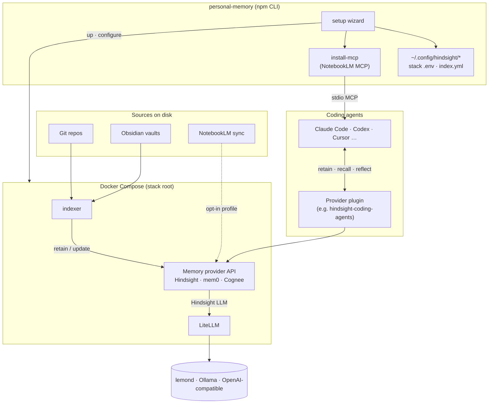

# personal-memory

[](https://www.npmjs.com/package/personal-memory)

**npm:** [personal-memory](https://www.npmjs.com/package/personal-memory) · **Docs:** [bcmyguest.github.io/personal-memory](https://bcmyguest.github.io/personal-memory/)

**Use the memory system you want** — not a single vendor lock-in. One wizard and shared indexer for coding agents; pick **Hindsight**, **mem0**, or **Cognee** (and add more via manifests). Hindsight is supported today; mem0 and Cognee are experimental. Architecture: [docs/architecture.md](docs/architecture.md) · contributor guide: [memory providers](docs/memory-providers.md).

## Quickstart

| Step | Command |
| --- | --- |
| 1. Wizard | `npx personal-memory` |
| 2. Check | `npx personal-memory doctor` |
| 3. NotebookLM MCP (optional) | `npx personal-memory install-mcp --yes --notebooklm` |

**Checkout instead of npx:**

```sh
git clone https://github.com/bcmyguest/personal-memory.git && cd personal-memory
npm install && npx . setup
```

**Needs:** Docker Compose v2, Node ≥ 20.12, and an LLM route if you use Hindsight (lemond, Ollama, or OpenAI-compatible — set in the wizard).

Day-2: `npx personal-memory up` · `down` · `switch <provider> --yes`


Full guide: [docs/quickstart.md](docs/quickstart.md) · [docs site](https://bcmyguest.github.io/personal-memory/docs/getting-started/)

## Architecture



| Connection | What it is |
| --- | --- |
| Wizard → stack | Provider, env, indexer image, compose up, smoke test |
| Sources → indexer | Shared watcher; sink from active provider manifest |
| Agents → provider | Hindsight plugin for session memory; `install-mcp` for NotebookLM MCP (and mem0/Cognee with `--provider-only`) |

Default Hindsight compose services: `litellm`, `hindsight` (API `127.0.0.1:8888`), `indexer`.

## Documentation

| Topic | File |
| --- | --- |
| Quickstart | [docs/quickstart.md](docs/quickstart.md) |
| Setup wizard | [docs/setup-wizard.md](docs/setup-wizard.md) |
| npx install, stack root | [docs/npx-install.md](docs/npx-install.md) |
| `config.toml` | [docs/personal-memory-config.md](docs/personal-memory-config.md) |
| Manual compose | [docs/manual-stack-setup.md](docs/manual-stack-setup.md) |
| Models (LiteLLM) | [docs/model-configuration.md](docs/model-configuration.md) |
| Indexing | [docs/indexing.md](docs/indexing.md) |
| NotebookLM | [docs/notebooklm.md](docs/notebooklm.md) |
| Coding agents / MCP | [docs/coding-agents.md](docs/coding-agents.md) |

## Logs and reset

```sh
npx personal-memory down
docker compose down -v   # from stack root: delete the memory database volume
docker compose logs -f indexer hindsight
```
