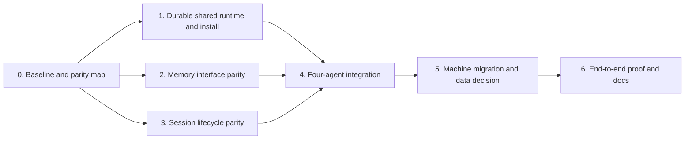

# Personal-memory revamp

**Goal status: active.** This file is the restart point for `/goal`. The objective is a personal-memory MCP, plugin, and skill with Hindsight-level coding-agent behavior across Claude Code, Codex, Cursor Agent, and OpenCode. The user explicitly chose to **keep the Hindsight server and stored data** while replacing its coding-agent plugin and skill. Do not mark the goal complete from configuration files alone.

## Source of truth and current state

- This repository and the active machine configuration are authoritative. `git status --short` currently shows uncommitted agent integration work plus a pre-existing untracked `compose.fabro.yaml`; leave that user file alone.
- `skills/personal-memory/SKILL.md` and `cli/coding-agent/*` contain the new skill, hooks, runtime installer, and OpenCode plugin. `cli/mcp/memory-facade.mjs` exposes nine `memory_*` tools across Hindsight, mem0, and Cognee.
- The prior session installed the new wiring globally and removed the upstream Hindsight coding-agent wiring from Claude Code, Codex, Cursor Agent, and OpenCode. A live `memory_recall` against the Hindsight backend worked; Claude and OpenCode MCP connection checks and Cursor's nine-tool listing worked. These checks prove connectivity, not Hindsight-level behavior or live session capture.
- The current Hindsight backend remains active by user choice. “Fully off Hindsight” in this goal means no upstream Hindsight coding-agent plugin or skill is required. Retain the server and data. A read-only local bank listing on 2026-10-22 returned 43 banks and 46,108 reported facts; no backend migration is part of this goal.
- The machine's legacy `~/.hindsight/coding-agent.json` currently says `optInOnly: true` with an empty `optInPaths` list. Current personal-memory hooks ignore it. Applying it unchanged would disable device-wide session memory; settle a personal-memory-owned policy before migrating settings.
- The prior turn was **progress**: it changed the worktree and machine wiring and produced live connectivity evidence. The broad objective remains incomplete.

## Work DAG

| Node | Status | Required evidence / next action |
| --- | --- | --- |
| 0. Baseline and parity map | in progress | Compare the installed Hindsight coding-agent skill/runtime to this repo: recall, reflection, knowledge pages, deliberate capture/correction, session retention, repo bank resolution, seeding/survey, diagnostics, opt-in rules, and failure behavior. Sol found the concrete gaps listed below; finish the parity inventory. |
| 1. Durable shared runtime and install | partial | Installer stages a stable runtime and global skill/MCP/hooks. A disposable-home test now covers Codex hook enablement (while preserving explicit `false`) and one-file OpenCode JSONC plugin/MCP merging with an existing comment and unrelated settings. Prove clean install and reinstall from a packed package, no cache paths, and provider switching. |
| 2. Memory interface parity | partial | Nine `memory_*` tools exist. Hindsight `memory_reflect` now calls its native `/reflect` endpoint; a focused test and live server response pass. The skill currently explains bank rules but offers no tool that tells an agent the resolved bank for its workspace, so explicit tool calls can still choose the wrong bank. Knowledge pages and initiative capture are absent. Define a provider-independent scope/knowledge interface and check retrieval quality against representative project questions. |
| 3. Session lifecycle parity | partial | OpenCode prompt injection, repeated-idle deduplication, and compaction fallback pass focused tests. Claude/Codex/Cursor Stop hooks now parse known or observed JSONL message/action rows with bounded cursors; exact-content, exclusion, retry, duplicate Stop, and rewrite tests pass. Codex officially treats its format as unstable. The Cursor adapter matches a local `agent-transcripts` sample, but live hook `transcript_path` linkage is unverified. Prove live behavior in all four agents and resolve remaining concurrency/large-tail limits. |
| 4. Four-agent integration | partial | Verify skill discovery, MCP launch/tool calls, and lifecycle behavior in fresh sessions of all four agents. A config entry or a unit test alone is insufficient. |
| 5. Machine integration cutover | partial | User chose to keep the Hindsight server. Upstream Hindsight coding-agent entries were removed in the prior turn; verify no upstream skill, plugin, hook, or MCP remains active in any of the four agents, refresh the personal-memory runtime, and prove each agent reaches the same server through the new interface. PMM portability repairs landed this turn but are outside the cutover path. |
| 6. End-to-end proof and docs | pending | Run relevant tests and real agent flows; update `README.md`, `CLAUDE.md`, and coding-agent docs with measured capabilities and limitations. Audit every row above before marking the goal complete. |

## Acceptance gates

1. In each fresh agent session, the skill is discoverable, `memory_*` calls work, relevant project memory is injected, and a completed turn is stored once in the correct bank.
2. Facts stored from one agent are retrievable from the other three in the same project bank. Worktrees and nested paths resolve consistently.
3. The replacement supports deliberate memory capture, corrections, retrieval, and any claimed Hindsight-level feature with observable behavior; docs identify any remaining provider-specific limits.
4. A clean install and a reinstall preserve unrelated settings. Staged paths survive `npx` cache removal. No upstream Hindsight coding-agent hook, MCP, skill, or OpenCode plugin is needed.
5. The active machine keeps the Hindsight server and data, while all four coding agents use only the personal-memory skill, hooks/plugin, and `memory_*` MCP for their memory workflow.
6. All relevant tests and live checks pass after the final code change. `git diff --check` is clean. The user-owned `compose.fabro.yaml` is untouched.

## Verified gap backlog

| Gap | Evidence | Acceptance check |
| --- | --- | --- |
| Hook opt-in and path mapping | Resolved in `hook-runner.mjs` and OpenCode plugin with a personal-memory-owned config. A missing config defaults device-wide; malformed config or invalid cwd denies. Legacy Hindsight settings remain separate. | Luna reviewers signed off; focused tests cover zero calls for denied/disabled/malformed paths, OpenCode session no-op, and mapped bank. Still verify live agent behavior. |
| OpenCode JSONC install split | Installer now selects the existing JSONC file for both plugin and MCP and keeps unrelated text/comments; disposable-home test passes. | Verify packed-package install and real OpenCode config loading. |
| Hindsight reflection route | Resolved in `memory-reflect-consolidate.mjs`: native `/reflect`, with returned answer and evidence. Focused test passes. A read-only call against the healthy local server returned HTTP 200 with `text` and `based_on` keys and a nonempty answer. | Keep cross-provider synthesis semantics accurate in docs. |
| Project knowledge lifecycle is absent | The installed Hindsight coding-agent skill describes first-open commit seeding, a code survey, refreshed knowledge pages, initiative capture, and sync status. The current `memory_*` interface has no matching pages, initiative, or readiness tools, and repo indexing tracks file changes rather than commit history. | A cold repo produces queryable history and structural context; agents can search/read refreshed project knowledge, capture/update an initiative, and inspect sync readiness through personal-memory tools without the upstream plugin. |
| Stop transcript retention | Resolved for known Claude and observed Codex/Cursor JSONL rows with bounded cursors and focused tests. Cursor adapter uses the local `agent-transcripts/*.jsonl` shape without copying private content into fixtures; unknown-only rows make no backend call/cursor. Live hook `transcript_path` linkage is unverified. | Verify real Claude/Codex/Cursor hook path/retention and concurrent Stop behavior. |
| Bank routing | Resolved in JS hook helper and Python indexer with reviewed precedence: active index.yml → personal-memory map → legacy Hindsight map → literal repo name. Root/nested, linked worktree, quoted-colon YAML, invalid/empty YAML, and test mappings have focused coverage; `yaml` YAML 1.1 dependency is staged with runtime. The root and nested path here both resolve `coding-agent::personal-memory`; synthetic linked checkout and indexer agree on `coding-agent::MainProject`. | Verify active indexer container is refreshed and live agents use the new bank. |
| Codex hooks on a fresh profile | Installer now sets `[features] hooks = true` when missing and preserves explicit `false`; disposable-home test passes. Current Codex docs say hooks are enabled by default but require review/trust for non-managed definitions. | Prove a fresh Codex session runs SessionStart and receives context after the hook definition is trusted. |

## Agent handoff protocol

1. On `/goal`, read this file, `git status --short`, current machine wiring, and the latest user answer about the backend boundary. Do not infer completion from this file's status labels.
2. Root owns this DAG and hands a bounded slice to a Luna orchestrator. That orchestrator sends implementation to a Luna worker, then review to a Luna reviewer; the reviewer returns concrete findings to the worker. A Sol scout independently looks for gaps. Keep reviewer and worker sequential if only one slot is free.
3. Workers do not edit `REVAMP.md` or global machine config. They report changed files, evidence, failures, and follow-up work to root. Root updates this DAG after verified changes.
4. Follow repository `AGENTS.md` and `/home/b/.codex/RTK.md`. Run relevant tests after code changes. Use `glab` for any GitLab operation. Never change existing tests merely to ratify an assumption.
5. If a turn ends before completion, leave the goal active and update the rows and the next action below. Mark it complete only after an evidence-backed audit of all acceptance gates.

## Next action

Luna worker/reviewer completed OpenCode lifecycle and access policy, hook access, bounded Claude/Codex/Cursor transcript retention, and shared bank routing slices. Root implemented OpenCode JSONC merging, fresh Codex hook activation, native Hindsight reflection, and three PMM portability repairs. Sol reproduced installer edge cases (commented feature header, missing newline, quoted MCP table, duplicate JSONC key); root fixed them. Focused JS tests for access, reflection, OpenCode, session hooks, transcript retention, and portability pass. Root installed the indexer's pinned `tree-sitter-language-pack==1.22.1` into `/tmp/pm-indexer-test-deps312` and ran the real `test_discovery.py` and `test_index.py` suite: 19 passed. `git diff --check` passes. JSONC comments inside rewritten fields may be lost. Cursor hook-path linkage remains unverified. A Luna worker/reviewer is adding an exact project-scope MCP tool next. After that: knowledge lifecycle, clean install proof, global runtime refresh, and four-agent live checks. User explicitly chose to keep the Hindsight server, so no backend migration is needed.
