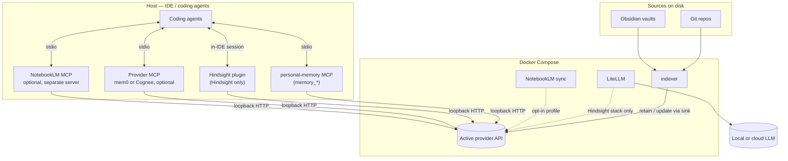
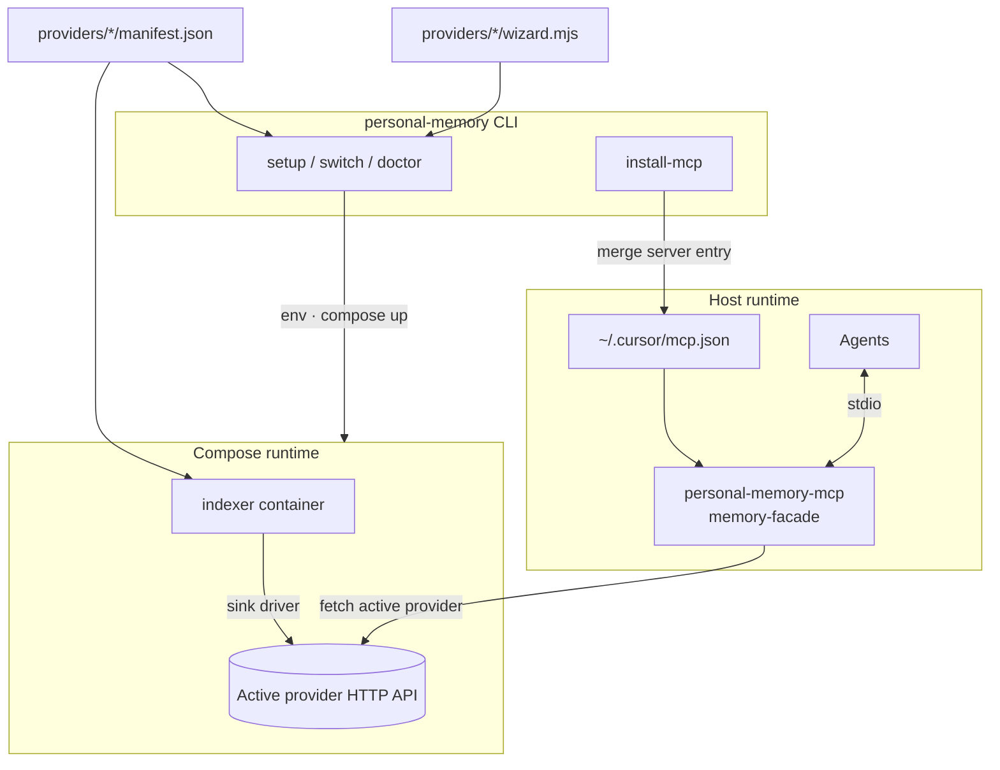

# Architecture

personal-memory’s job is **not** to be the memory — it is to let you run **whichever memory system you choose** on one machine with shared indexing and setup. A **shared indexer** writes into the active **provider**; **coding agents** use that provider’s native plugin or MCP (Hindsight plugin, mem0 MCP, and so on). Only one provider is active at a time; `npx personal-memory switch` rewires the stack without pretending to migrate your data. Setup (`npx personal-memory`) is install plumbing only — not part of the runtime data path.

## Runtime data flow

Two paths share one **active provider API** (Hindsight, mem0, or Cognee — never more than one). Setup (`npx personal-memory`) is not on this diagram; see [How personal-memory interfaces with providers](#how-personal-memory-interfaces-with-providers).

| Path | What moves |
| --- | --- |
| **Indexing** | Git/Obsidian → indexer → provider HTTP sink (`MEMORY_SINK` from manifest) |
| **Agents** | Cursor/Claude/Codex → stdio MCP or plugin → same provider API |
| **Unified MCP** | `install-mcp` registers `personal-memory` on the host; tools delegate to the active provider |
| **LiteLLM** | **Hindsight only.** Sidecar that routes Hindsight retain/reflect/consolidate calls to lemond, Ollama, or another OpenAI-compatible endpoint — not used on mem0/Cognee stacks |
| **NotebookLM sync** | **Opt-in, any active provider.** Background sync writes into `notebooklm::*` via the same indexer sinks (Hindsight / mem0 / Cognee); not the same as the NotebookLM MCP |
| **Provider MCP** | Native mem0 or Cognee tool names (`install-mcp --provider-only`); same API as unified MCP, different stdio server |
| **NotebookLM MCP** | Read-only list/search over synced notebooks; separate entry in `mcp.json`, not a memory provider |

Only **one provider** is active at a time (`MEMORY_PROVIDER`). The indexer uses that provider’s HTTP sink (`MEMORY_SINK` / manifest).

## How personal-memory interfaces with providers

personal-memory is a **meta layer**: it does not replace provider APIs. It wires the same plumbing (indexer, compose, wizard, MCP) to **different backends** through manifests and thin adapters.

### Integration layers

| Layer | What it is | Repo location |
| --- | --- | --- |
| **Manifest** | Status, compose services, ports, indexer sink id, smoke HTTP templates | `providers/<id>/manifest.json` |
| **Wizard hooks** | Provider-specific env, keys, smoke, coding-agent notes | `providers/<id>/wizard.mjs` |
| **Indexer sink** | Poll/vault → retain/update/delete on the provider API | `indexer/` (driver id in manifest, e.g. `hindsight-rest-v1`, `mem0-rest`) |
| **Unified MCP** | Stable `memory_*` tools → provider HTTP | `cli/mcp/memory-facade.mjs`, `cli/personal-memory-mcp.mjs` |
| **Native agent paths** | Plugin or provider MCP (unchanged upstream tool names) | Hindsight plugin; `cli/mem0-mcp.mjs`, `cli/cognee-mcp.mjs`, NotebookLM |

Adding a provider means a new manifest + hooks + sink driver; agents can keep using **`memory_*`** once the facade implements that backend.

### Runtime wiring (env and config)

| Input | Resolves |
| --- | --- |
| `MEMORY_PROVIDER` | Active backend (`wizard.conf`, optional `config.toml`) |
| Stack `.env` | API URLs, ports, `MEMORY_SINK`, indexer → provider URL |
| Provider secret files | e.g. `~/.config/personal-memory/mem0.env` (never committed; not written to `mcp.json`) |
| `~/.config/hindsight/index.yml` | What the indexer watches |

`npx personal-memory switch <id>` updates provider selection and restarts compose; it does **not** migrate memories ([export/import](memory-portability.md) is for that).

### Example: unified MCP on mem0

1. `npx personal-memory switch mem0 --yes` — compose and env point the indexer and unified MCP at `MEM0_API_URL`.
2. `npx personal-memory install-mcp --yes` — merges the `personal-memory` server into `~/.cursor/mcp.json` (NotebookLM MCP only if you enabled sync or pass `--notebooklm`).
3. The agent calls `memory_add` with `{ content: "…", bank: "my-project" }`. The facade sends `POST /memories` with `user_id=my-project` and `infer: false`.

`install-mcp --provider-only` is a **different** stdio server: same mem0 API, but upstream mem0 tool names from `@yeyuan98/mem0-mcp`. NotebookLM MCP is **different again** — search over notebooks synced into Hindsight, not a substitute for mem0/Cognee/Hindsight memory.

### Unified MCP → provider HTTP

The `personal-memory` MCP server delegates each tool to the **active** provider:

| Unified tool | Hindsight (`HINDSIGHT_URL`) | mem0 (`MEM0_API_URL` + key file) | Cognee (`COGNEE_API_URL`) |
| --- | --- | --- | --- |
| `memory_add` | `POST /v1/default/banks/{bank}/memories` | `POST /memories` (`infer: false`, `user_id` from `bank` arg) | `POST /api/v1/add` |
| `memory_search` / `memory_recall` | `POST /v1/default/banks/{bank}/memories/recall` | `POST /search` with `filters.user_id` | `POST /api/v1/search` |
| `memory_forget` | `DELETE /v1/default/banks/{bank}` (bank scope) | `DELETE /memories/{id}` | Not exposed yet |
| `memory_provider_status` | Returns provider id + loopback URL | Same | Same |
| `memory_export` / `memory_import` | PMM envelope; mem0 list/add — see [Memory portability](memory-portability.md) | | |

Default scope key for MCP-created rows: bank / `user_id` **`personal-memory-mcp`** unless the tool passes `bank`.

### Native agent paths (optional, alongside unified MCP)

| Provider | Session / tools | Install |
| --- | --- | --- |
| **Hindsight** | `@vectorize-io/hindsight-coding-agents` plugin (retain / recall / reflect) | Wizard coding-agent step |
| **mem0** | `@yeyuan98/mem0-mcp` tools | `install-mcp --provider-only` |
| **Cognee** | `cognee_health`, `cognee_search` | `install-mcp --provider-only` |
| **NotebookLM** | `notebooklm_list_banks`, `notebooklm_search` | `install-mcp` when sync enabled or `--notebooklm` |

`install-mcp` merges the **unified** `personal-memory` server by default (`--no-unified-mcp` to skip).

## How file changes become memory

The indexer does not watch your editor — it watches **repositories and vaults** on a schedule.

| Source | Detection | What gets sent to the provider |
| --- | --- | --- |
| Git repo | Poll every `poll_seconds` (default 60): `HEAD` + tracked-file status | Tree-sitter outlines + text for changed files → **retain** on the active sink |
| Obsidian vault | inotify; re-index after `vault_quiet_seconds` (default 30) without edits | Vault documents → provider-specific banks |
| New repo/vault under scan roots | Re-list sources every `relist_seconds` (default 600) | Picked up without restarting the stack |

Configuration: `~/.config/hindsight/index.yml` (wizard writes this on first setup). Filters such as `optInPaths` in `~/.hindsight/coding-agent.json` can limit which discovered sources are indexed.

Hindsight names banks `obsidian::<slug>`, `coding-agent::<repo>`, optional `notebooklm::*`. mem0 uses `user_id` / `agent_id` / `run_id`; Cognee uses **datasets** mapped from indexer banks.

## Industry context

There is **no** cross-vendor standard for agent memory APIs. MCP standardizes tool transport, not memory semantics — each product exposes different tool names and shapes. personal-memory’s answer is a **stable facade** on your chosen backend so agents keep the same verbs when you switch providers.

## Unified personal-memory MCP (beta)

`cli/personal-memory-mcp.mjs` registers as the `personal-memory` server in `~/.cursor/mcp.json` when you run `install-mcp` (unless `--no-unified-mcp`). It delegates to the active provider:

| Tool | Purpose |
| --- | --- |
| `memory_add` | Store text (Hindsight bank, mem0 user scope, Cognee dataset add) |
| `memory_search` / `memory_recall` | Query memories on the active backend |
| `memory_forget` | Delete by id (mem0) or drop a Hindsight bank |
| `memory_provider_status` | Active provider and loopback URL (no secrets) |
| `memory_export` / `memory_import` | PMM portable format — [Memory portability](memory-portability.md) (mem0 beta) |

Hindsight **session** retain/recall in the editor still uses the [`@vectorize-io/hindsight-coding-agents`](https://www.npmjs.com/package/@vectorize-io/hindsight-coding-agents) plugin; the unified MCP is for the same stable tool names across providers (and automation that speaks MCP).

### Other MCP integrations

| Integration | Tools / path | Role |
| --- | --- | --- |
| Hindsight plugin | retain / recall / reflect in session | Primary in-IDE session memory |
| `notebooklm` (`install-mcp`) | `notebooklm_list_banks`, `notebooklm_search` | Opt-in synced notebooks |
| `mem0` (`--provider-only`) | mem0 REST tools via `@yeyuan98/mem0-mcp` | Native mem0 tool names |
| `cognee` (`--provider-only`) | `cognee_health`, `cognee_search` | Native Cognee read-only MCP |

## Related

- [Memory portability](memory-portability.md) — PMM export/import
- [Provider status](https://bcmyguest.github.io/personal-memory/docs/provider-status/) — manifest status and ports
- [mem0 operator guide](mem0.md) — URL-only mem0 setup
- [Cognee operator guide](cognee.md) — loopback container + LLM env
- [Configuration file](personal-memory-config.md) — `config.toml` for provider and stack defaults

Developer docs (wizard phases, hooks, manual compose, [indexer sinks](https://github.com/bcmyguest/personal-memory/blob/main/docs/indexer-sinks.md), [MCP install modes](https://github.com/bcmyguest/personal-memory/blob/main/docs/mcp-install-guide.md)) live in the git repository under `docs/` and are not published on this site. See also [Pluggable memory providers](https://github.com/bcmyguest/personal-memory/blob/main/docs/memory-providers.md).
