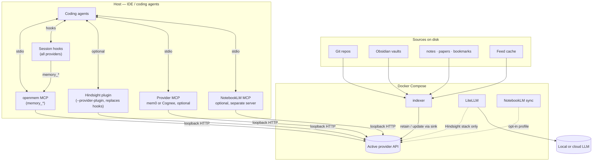
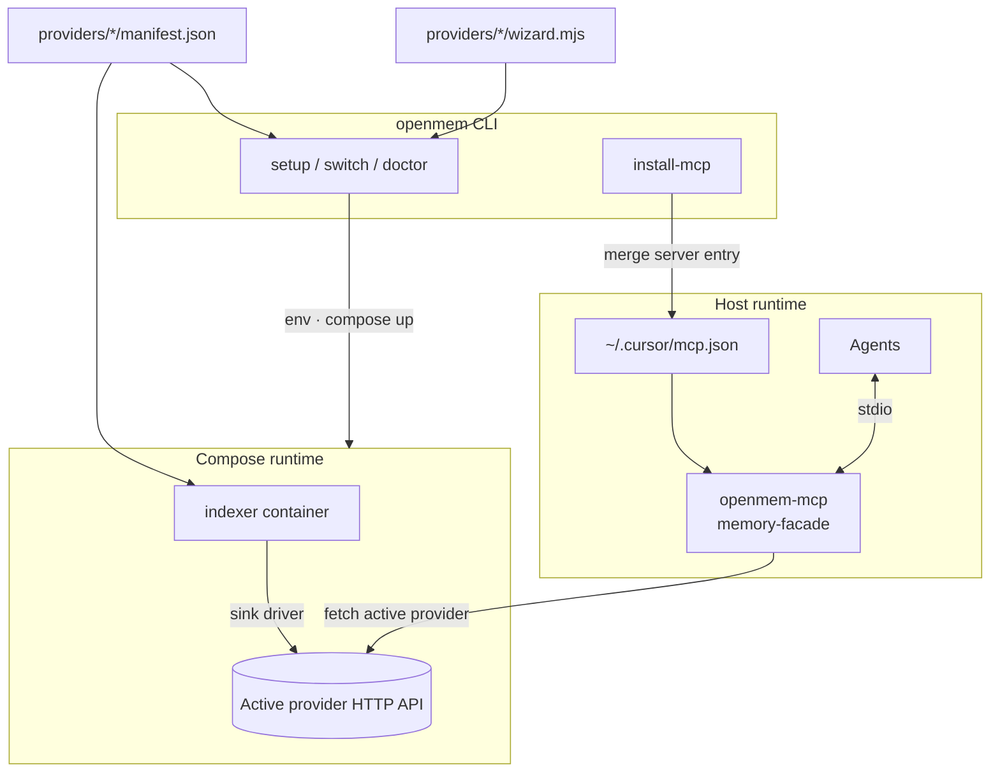

# Architecture

OpenMem connects coding agents and a shared indexer to one active [memory provider](provider-status.md). Agents use the stable `memory_*` MCP and session hooks; the indexer writes sources to the same provider. This page shows the full runtime paths and optional integrations. Setup (`npx @bcmyguest/openmem`) configures them but is outside the runtime data path. Switching providers does not migrate memories.

## Overview

Two paths. **A, memory:** sources go through the indexer into one active provider, which agents reach through the `memory_*` MCP and session hooks. **B, context management:** the context proxy (OpenCode 2: a native plugin) keeps each session under `trim_at_tokens` by moving older turns to a local session store that the agent searches; no model call summarizes them. OpenMem parts are tinted.

<picture>
<source media="(prefers-color-scheme: dark)" srcset="https://bcmyguest.github.io/openmem/media/overview-memory-dark.png" />

</picture>
<picture>
<source media="(prefers-color-scheme: dark)" srcset="https://bcmyguest.github.io/openmem/media/overview-context-dark.png" />

</picture>
 
A, memory · B, context management

The sections below show every runtime path and optional integration.

## Runtime data flow

Two paths share one **active provider API** (Hindsight, mem0, or Cognee — never more than one). Setup (`npx @bcmyguest/openmem`) is not on this diagram; see [How openmem interfaces with providers](#how-openmem-interfaces-with-providers).

| Path | What moves |
| --- | --- |
| **Indexing** | Git, Obsidian, markdown trees, feed cache → indexer → provider HTTP sink (`MEMORY_SINK` from manifest) |
| **Agents** | Cursor/Claude/Codex → session hooks and/or MCP → same provider API |
| **Unified MCP** | `install-mcp` registers `openmem` on the host; tools delegate to the active provider |
| **LiteLLM** | Optional sidecar on Hindsight stacks; also used for **cross-provider reflect synthesis** when `PM_LLM_URL` / stack LiteLLM is reachable (`memory_reflect` on mem0/Cognee) |
| **NotebookLM sync** | **Opt-in, any active provider.** Background sync writes into `notebooklm::*` via the same indexer sinks (Hindsight / mem0 / Cognee); not the same as the NotebookLM MCP |
| **Provider MCP** | Native mem0 or Cognee tool names (`install-mcp --provider-only`); same API as unified MCP, different stdio server |
| **NotebookLM MCP** | Read-only list/search over synced notebooks; separate entry in `mcp.json`, not a memory provider |

Only **one provider** is active at a time (`MEMORY_PROVIDER`). The indexer uses that provider’s HTTP sink (`MEMORY_SINK` / manifest).

## How openmem interfaces with providers

Product framing: [Concepts](concepts.md).

OpenMem connects the indexer, Compose, wizard, and MCP to the selected provider through its manifest and adapter. Provider support levels come from [Provider status](provider-status.md).

### Integration layers

| Layer | What it is | Repo location |
| --- | --- | --- |
| **Manifest** | Status, compose services, ports, indexer sink id, smoke HTTP templates | `providers/<id>/manifest.json` |
| **Wizard hooks** | Provider-specific env, keys, smoke, coding-agent notes | `providers/<id>/wizard.mjs` |
| **Indexer sink** | Poll/vault → retain/update/delete on the provider API | `indexer/` (driver id in manifest, e.g. `hindsight-rest-v1`, `mem0-rest`) |
| **Unified MCP** | Stable `memory_*` tools → provider HTTP | `cli/mcp/memory-facade.mjs`, `cli/openmem-mcp.mjs` |
| **Native agent paths** | Session hooks or provider plugin (`[agents] integration`) + optional MCP | `cli/coding-agent/hook-runner.mjs`; optional Hindsight plugin; `cli/mem0-mcp.mjs`, `cli/cognee-mcp.mjs`, NotebookLM |

Adding a provider means a new manifest + hooks + sink driver; agents can keep using **`memory_*`** once the facade implements that backend.

### Runtime wiring (env and config)

| Input | Resolves |
| --- | --- |
| `MEMORY_PROVIDER` | Active provider (`wizard.conf`, optional `config.toml`) |
| Stack `.env` | API URLs, ports, `MEMORY_SINK`, indexer → provider URL |
| Provider secret files | e.g. `~/.config/personal-memory/mem0.env` (never committed; not written to `mcp.json`) |
| `~/.config/hindsight/index.yml` | What the indexer watches |

`npx @bcmyguest/openmem switch <id>` updates provider selection and restarts compose; it does **not** migrate memories ([export/import](memory-portability.md) is for that).

### Example: unified MCP on mem0

1. `npx @bcmyguest/openmem switch mem0 --yes` — compose and env point the indexer and unified MCP at `MEM0_API_URL`.
2. `npx @bcmyguest/openmem install-mcp --yes` — merges the `openmem` server into `~/.cursor/mcp.json` (NotebookLM MCP only if you enabled sync or pass `--notebooklm`).
3. The agent calls `memory_add` with `{ content: "…", bank: "my-project" }`. The facade sends `POST /memories` with `user_id=my-project` and `infer: false`.

`install-mcp --provider-only` is a **different** stdio server: same mem0 API, but upstream mem0 tool names from `@yeyuan98/mem0-mcp`. NotebookLM MCP is **different again** — search over notebooks synced into Hindsight, not a substitute for mem0/Cognee/Hindsight memory.

### Unified MCP → provider HTTP

The `openmem` MCP server delegates each tool to the **active** provider:

| Unified tool | Hindsight (`HINDSIGHT_URL`) | mem0 (`MEM0_API_URL` + key file) | Cognee (`COGNEE_API_URL`) |
| --- | --- | --- | --- |
| `memory_add` | `POST /v1/default/banks/{bank}/memories` | `POST /memories` (`infer: false`, `user_id` from `bank` arg) | `POST /api/v1/add` |
| `memory_search` / `memory_recall` | `POST /v1/default/banks/{bank}/memories/recall` | `POST /search` with `filters.user_id` | `POST /api/v1/search` |
| `memory_reflect` | Same recall path | Search + optional LiteLLM synthesis | Search + optional LiteLLM synthesis |
| `memory_consolidate` | LiteLLM / Hindsight consolidate routes | Skipped (no equivalent) | `POST /api/v1/cognify` |
| `memory_forget` | `DELETE /v1/default/banks/{bank}` (bank scope) | `DELETE /memories/{id}` | Not exposed yet |
| `memory_provider_status` | Returns provider id + loopback URL | Same | Same |
| `memory_export` / `memory_import` | PMM envelope; mem0 list/add — see [Portable memory (PMM)](memory-portability.md) | | |

Default scope key for MCP-created rows: bank / `user_id` **`openmem-mcp`** unless the tool passes `bank`.

### Native agent paths (optional, alongside unified MCP)

| Provider | Session / tools | Install |
| --- | --- | --- |
| **All providers** | In-repo session hooks → unified `memory_*` (`[agents] integration = "openmem"`, default) | `install-coding-agent --yes` |
| **Hindsight (optional)** | `@vectorize-io/hindsight-coding-agents` plugin instead of the session hooks (`integration = "provider"`) | `install-coding-agent --provider-plugin` |
| **mem0** | `@yeyuan98/mem0-mcp` tools | `install-mcp --provider-only` |
| **Cognee** | `cognee_health`, `cognee_search` | `install-mcp --provider-only` |
| **NotebookLM** | `notebooklm_list_banks`, `notebooklm_search` | `install-mcp` when sync enabled or `--notebooklm` |

`install-mcp` merges the **unified** `openmem` server by default (`--no-unified-mcp` to skip).

## How file changes become memory

The indexer does not watch your editor — it watches **configured sources** on disk (poll, inotify, or periodic re-list).

| Source | Detection | What gets sent to the provider |
| --- | --- | --- |
| Git repo | Poll every `poll_seconds` (default 60): `HEAD` + tracked-file status | Tree-sitter outlines + text for changed files → **retain** on the active sink |
| Obsidian vault | inotify; re-index after `vault_quiet_seconds` (default 30) without edits | Vault documents → provider-specific banks |
| Notes / papers / bookmarks | `notes.paths`, `papers.paths`, `bookmarks.paths`; inotify on `.md` (bookmarks also `.html`, `.txt`) | Markdown (and bookmark exports) → `notes::`, `papers::`, `bookmarks::` banks |
| Feed cache | `feeds.out_dir` after `npx @bcmyguest/openmem feed-sync` (RSS / OpenAlex) | Generated markdown → `feed::` banks |
| New sources under scan roots | Re-list every `relist_seconds` (default 600) | Picked up without restarting the stack |

Configuration: `~/.config/hindsight/index.yml` (wizard writes this on first setup). Full source list and examples: [index-sources.md](index-sources.md) · [sources-feeds.md](sources-feeds.md) · [sources-zotero.md](sources-zotero.md) · [sources-readwise.md](sources-readwise.md). Filters such as `optInPaths` in `~/.hindsight/coding-agent.json` can limit which discovered sources are indexed.

Bank prefixes include `coding-agent::`, `obsidian::`, `notes::`, `papers::`, `bookmarks::`, `feed::`, and optional `notebooklm::*`. mem0 uses `user_id` / `agent_id` / `run_id`; Cognee uses **datasets** mapped from indexer banks.

## Industry context

There is **no** cross-vendor standard for agent memory APIs. MCP standardizes tool transport, not memory semantics — each product exposes different tool names and shapes. openmem’s answer is a **stable facade** on your chosen backend so agents keep the same verbs when you switch providers.

## Unified openmem MCP (beta)

`cli/openmem-mcp.mjs` registers as the `openmem` server in `~/.cursor/mcp.json` when you run `install-mcp` (unless `--no-unified-mcp`). It delegates to the active provider:

| Tool | Purpose |
| --- | --- |
| `memory_add` | Store text (Hindsight bank, mem0 user scope, Cognee dataset add) |
| `memory_search` / `memory_recall` | Query memories on the active backend |
| `memory_reflect` | Session-style context (recall or search + optional LiteLLM) |
| `memory_consolidate` | Cognee cognify; Hindsight notes; mem0 skip |
| `memory_forget` | Delete by id (mem0) or drop a Hindsight bank |
| `memory_provider_status` | Active provider and loopback URL (no secrets) |
| `memory_export` / `memory_import` | PMM portable format — [Portable memory (PMM)](memory-portability.md) |
| `memory_project_scope` | Resolve a workspace's bank and hook access (local) |
| `memory_pages_list` / `memory_pages_search` / `memory_pages_read` | List, search, and read curated knowledge pages (Hindsight; others return `supported: false`) |
| `memory_capture_initiative` | Record an approved feature plan as a tracked initiative page plus marker memory (Hindsight) |
| `memory_status` | Async ingest drain state and operation status (Hindsight; mem0 always ready) |
| `smart_compact_search` | Search a session's SQLite store of every message (FTS5 BM25 `query`, merged with embeddings when present, or a `pattern` regex), filtered by `role` and `in_context`, with `context` neighbouring rows (local files, every provider) — [Context store](context-store.md) |
| `smart_compact_sql` | One read-only SELECT against a session database, for counts and aggregates (2 s, 200 rows) |
| `smart_compact_get` | Return the full text of a compressed tool result by blob id, paged at 100k chars (local files, every provider) |

**Session hooks** (all providers) call the unified MCP via `cli/coding-agent/hook-runner.mjs`. Optional [`@vectorize-io/hindsight-coding-agents`](https://www.npmjs.com/package/@vectorize-io/hindsight-coding-agents) replaces them on Hindsight stacks: `--provider-plugin` sets `[agents] integration = "provider"`, removes OpenMem's hooks and keeps the unified MCP; `--no-provider-plugin` switches back. `--hindsight-plugin` was renamed to `--provider-plugin`. See [Coding-agent hooks](coding-agent-hooks.md).

### Other MCP integrations

| Integration | Tools / path | Role |
| --- | --- | --- |
| Session hooks | SessionStart / prompt / Stop → `memory_*` | Default in-IDE session memory (all providers) |
| Hindsight plugin (optional) | Upstream retain / recall / reflect, instead of the session hooks | `--provider-plugin` only |
| `notebooklm` (`install-mcp`) | `notebooklm_list_banks`, `notebooklm_search` | Opt-in synced notebooks |
| `mem0` (`--provider-only`) | mem0 REST tools via `@yeyuan98/mem0-mcp` | Native mem0 tool names |
| `cognee` (`--provider-only`) | `cognee_health`, `cognee_search` | Native Cognee read-only MCP |

## Related

- [Portable memory (PMM)](memory-portability.md) — export/import
- [MCP setup](mcp-setup.md) — unified and provider-native MCP
- [Provider status](provider-status.md) — manifest status and ports
- [mem0 operator guide](mem0.md) — URL-only mem0 setup
- [Cognee operator guide](cognee.md) — loopback container + LLM env
- [Configuration file](openmem-config.md) — `config.toml` for provider and stack defaults

Contributor-only guides (wizard phases, hooks, manual compose, [indexer sinks](indexer-sinks.md), [pluggable providers](memory-providers.md)) live under `docs/` in git and are not all published on the site. Day-to-day MCP install is on [MCP setup](mcp-setup.md).
