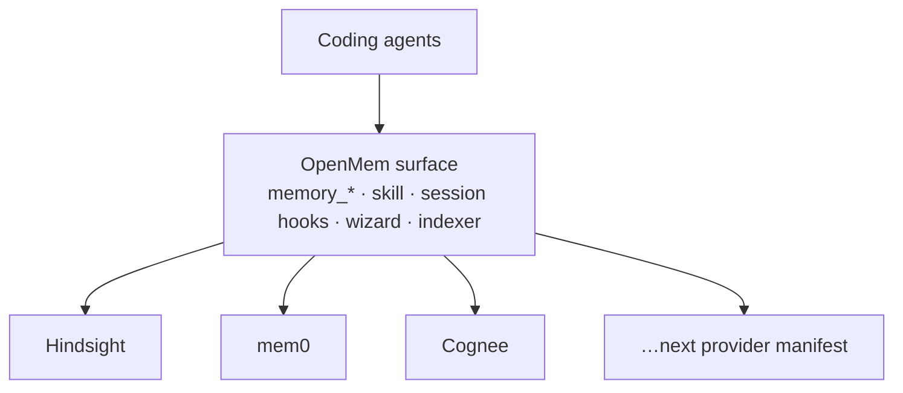

# Concepts

OpenMem is a **memory interface for coding agents**: a stable API and operator surface, with pluggable backends underneath.

## What’s coding-agent memory?

Coding agents forget between sessions. A memory system stores durable facts, decisions, and project context so the next turn (or agent) can recall them without re-deriving everything from the repo.

In practice that means:

- **Write** — retain notes, session transcripts, indexed sources
- **Read** — search, recall, or synthesize an answer from stored memories
- **Scope** — keep personal notes, vaults, and per-repo banks from colliding
- **Operate** — run a backend locally (or point at one), keep secrets off the wire you did not choose

Full use of memory needs a **memory system**: an API (or library) plus storage, extraction, and usually an admin or ops path. Hindsight, mem0, Cognee, and in-house stores are examples. Each has its own API, deploy story, and agent wiring.

## What’s OpenMem?

OpenMem is **not** a memory engine. It is the layer that sits between coding agents and whichever engine you run:

| Layer | Role |
| --- | --- |
| **Agents** | Claude Code, Codex, Cursor Agent, OpenCode — call stable `memory_*` tools and share one skill |
| **OpenMem** | Wizard, Compose, indexer, unified MCP, session hooks, import/export formats |
| **Provider** | Hindsight, mem0, Cognee, or the next manifest — owns semantics, storage, and native APIs |

One active provider at a time. `openmem switch` rewires the stack; it does not pretend to migrate your data. Portability is explicit through the format layer (PMM today).

## Why an interface layer?

Without a shared front door, every agent and indexer hard-codes one vendor’s SDK or HTTP shape. Switching backends means rewriting hooks, MCP entries, and indexing. Trying a second system means a second install path.

Standardizing the **agent and ops surface** means:

- Keep using your current memory product
- Try another backend without rewriting agent prompts and MCP tool names
- Share indexer, wizard, and install plumbing across backends
- Grow a community of providers behind one contract

OpenMem owns machine plumbing. Providers own memory quality.

## Core pieces

### Providers

A **provider** is the translation layer between OpenMem and a memory backend. It maps manifests, Compose fragments, wizard hooks, and an indexer sink onto that product’s API so agents and the indexer stay backend-agnostic.

Ship a provider as `providers/<id>/` (manifest + hooks + compose). Status (`supported` / `experimental` / `planned`) comes from the manifest. See [Provider status](provider-status.md) and [Pluggable memory providers](memory-providers.md).

Only one provider is registered as active (`MEMORY_PROVIDER`). Switching replaces the active backend for Compose, the indexer sink, and unified MCP.

### Evaluation API (`memory_*`)

Agents do not call Hindsight or mem0 tool names by default. They call a **stable tool set** on the `openmem` MCP server:

| Tool | Intent |
| --- | --- |
| `memory_add` | Store a durable record |
| `memory_search` / `memory_recall` | Retrieve |
| `memory_reflect` / `memory_consolidate` | Synthesize (provider-dependent) |
| `memory_forget` | Delete (scoped; confirm before bulk) |
| `memory_export` / `memory_import` | Portability (PMM) |
| `memory_provider_status` / `memory_project_scope` | Ops / bank resolution |
| `memory_pages_list` / `memory_pages_search` / `memory_pages_read` | Curated knowledge pages (Hindsight) |
| `memory_capture_initiative` | Track an approved feature plan (Hindsight) |
| `memory_status` | Ingest drain state (Hindsight; mem0 always ready) |
| `smart_compact_search` / `smart_compact_get` | Recover trimmed session context and compressed tool results (local, every provider) |

The facade (`cli/mcp/memory-facade.mjs`) maps each call onto the active provider’s HTTP API. Native provider MCP (`install-mcp --provider-only`) remains available when you want vendor tools.

### Context and banks

**Bank** (or provider-equivalent `user_id` / dataset) is the scope key for a write or read. Default MCP scope is `openmem-mcp`. Project work should pass the resolved project bank so session noise does not land in the default.

Resolution order: longest matching `index.yml` bank prefix → `~/.config/personal-memory/coding-agent.json` `mapPathToBank` → legacy Hindsight mapping → `coding-agent::<repo-directory-name>`. Details: [Coding-agent scopes](coding-agent-scopes.md).

### Formats

Import/export goes through a **format layer**, not a provider-specific dump. **PMM** (Personal Memory Manifest) is the first format; more formats plug into the same orchestrator. See [Portable memory (PMM)](memory-portability.md).

### Session hooks and skill

OpenMem installs one **skill** and **session hooks** (SessionStart / prompt / Stop) so agents recall and retain without remembering a vendor SDK. Hook sets are exclusive: `[agents] integration` is `openmem` (default) or `provider`, which swaps in the upstream Hindsight plugin (`--provider-plugin`; `--no-provider-plugin` switches back).

### Indexer

A shared **indexer** watches git repos, Obsidian vaults, notes trees, and feed caches, then writes through the active provider’s sink. Sources are provider-agnostic; only the sink changes with `MEMORY_PROVIDER`.

## What OpenMem is not

- A replacement for Hindsight, mem0, or Cognee product UIs
- A guarantee that memories move losslessly between backends (export/import is explicit)
- A multi-provider fan-out in one process (one active provider; switch to change)

## Related projects and inspiration

OpenMem is not affiliated with these projects.

| Project | Role here |
| --- | --- |
| [OpenFeature](https://openfeature.dev/) | Vendor-agnostic interface over pluggable providers — the model for `memory_*` over memory backends |
| [mise](https://mise.jdx.dev/) / [asdf](https://asdf-vm.com/) | One CLI over many backends with declarative config |
| [Hindsight](https://github.com/vectorize-io/hindsight) · [mem0](https://github.com/mem0ai/mem0) · [Cognee](https://github.com/topoteretes/cognee) | Memory providers |
| [Hindsight coding agents](https://www.npmjs.com/package/@vectorize-io/hindsight-coding-agents) | Reference for knowledge pages, initiatives and ingest status; replaced by OpenMem hooks in `openmem` mode |
| [LiteLLM](https://github.com/BerriAI/litellm) | Model proxy for Hindsight; hosts the [context proxy](context-proxy.md) |
| [Mainplane](https://github.com/mainplane-ai/mainplane) | Smart compaction model: fresh context plus a pointer to the saved transcript, retrieved on demand |
| [rtk](https://github.com/rtk-ai/rtk) | Shell-output compaction (`rtk init` when installed); its proxy's pointer-and-retrieve compression of large tool results inspired the context proxy's |
| [Meridian](https://github.com/rynfar/meridian) | Claude subscription as an Anthropic-compatible API; optional Hindsight model backend ([guide](meridian-litellm.md)) |
| [OpenCode](https://opencode.ai/) · [Claude Code hooks](https://code.claude.com/docs/en/hooks) · [Codex hooks](https://developers.openai.com/codex/hooks) | Agent APIs OpenMem translates between ([compatibility](compatibility.md)) |

## Next

| Doc | Use when |
| --- | --- |
| [Quickstart](quickstart.md) | First install |
| [MCP setup](mcp-setup.md) | Unified `memory_*` MCP, native mem0/Cognee, NotebookLM |
| [Portable memory (PMM)](memory-portability.md) | Export/import between providers |
| [Architecture](architecture.md) | Runtime data paths |
| [Provider status](provider-status.md) | Which backends ship |
| [Compatibility](compatibility.md) | What each agent and provider supports, with evidence level |
| [mem0](mem0.md) · [Hindsight](hindsight.md) · [Cognee](cognee.md) | Provider operator guides |
