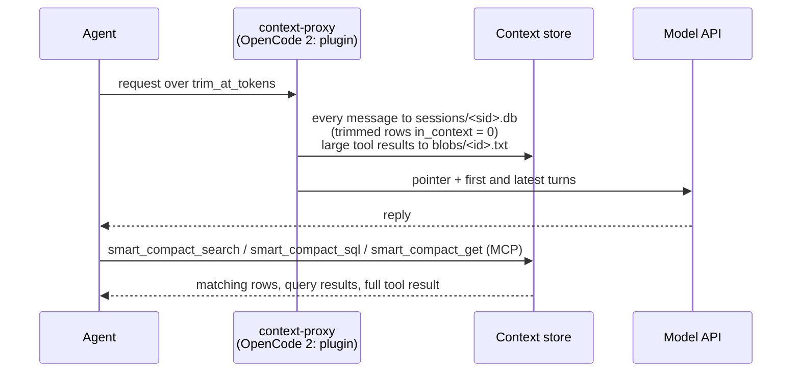

# Context management

Context management (smart compaction) keeps long coding-agent sessions under a token limit without an LLM summary. Every message goes into a local SQLite session store; older turns leave the context and a pointer takes their place; the agent searches the store when it needs a detail back.



Each request goes through five steps ([context proxy](context-proxy.md) has the details):

| Step | When | Effect |
| --- | --- | --- |
| Tool-result compression | A tool result exceeds `compress_over_tokens` | First 40 and last 20 lines stay, behind a `smart_compact_get(id=...)` header; the full text goes to `blobs/<id>.txt` |
| Store | Every request | Each message goes into `sessions/<sid>.db` once, keyed by a chained fingerprint, with an `in_context` flag ([context store](context-store.md#session-database)) |
| Trim | The request reaches `trim_at_tokens`, or the user typed `/smart-compact` | Turns before the last real user turn leave the context and their rows get `in_context = 0`; a pointer naming `smart_compact_search` / `smart_compact_sql` replaces them. System prompt, tools, the first user turn and the in-flight turn stay verbatim |
| Recall on trim | The session registration names a bank | Memory recall for the last prompt follows the pointer, capped at `[compaction] max_chars`. Proxy: Hindsight only. OpenCode 2 plugin: any provider |
| Standing instruction | Every request | A constant system-prompt note tells the agent to call `smart_compact_search` before answering from content it cannot see |

The cut is sticky: later requests with the same history get the same rewrite byte for byte, so the prompt cache keeps hitting. A trim invalidates the cache once.

## When to turn it on

| Turn it on when | Leave it off when |
| --- | --- |
| Sessions grow past `trim_at_tokens` (default 120,000 estimated tokens) | Sessions stay under that limit |
| You want trimmed turns searchable instead of summarized away | You cannot run the `context-proxy` container (Claude Code and OpenCode 1 send every request to it and fail while it is down) |
| You use Claude Code or OpenCode (OpenCode 2 needs no container) | You use only Codex or Cursor CLI (neither is routed through the proxy) |

The thresholds are untuned defaults.

## Turn it on or off

The switch is per agent. `[context_proxy.agents]` holds one key per agent; a missing key follows the master switch `[context_proxy] enabled`. With neither set, OpenCode 2 is on (it needs no service) and the proxy-routed agents are off.

```toml
[context_proxy]
enabled = true            # master switch
[context_proxy.agents]    # optional overrides; missing = follow `enabled` (unset: opencode2 on, others off)
claude-code = true
opencode1   = true
codex       = false
opencode2   = true        # native plugin, no service
```

| Key | Served by | Needs the `context-proxy` service |
| --- | --- | --- |
| `claude-code` | `context-proxy` | yes |
| `opencode1` | `context-proxy` | yes |
| `opencode2` | OpenMem's OpenCode 2 plugin | no |
| `codex` | not routed yet (see [Agent support](#agent-support)) | no |

| Where | How |
| --- | --- |
| Setup wizard | Step 8 "Context management (smart compaction)": tick the installed agents to trim |
| CLI | `npx @bcmyguest/openmem context on [--agents a,b]` / `context off [--agents a,b]`; without `--agents`, all four |
| Config | Edit the keys above, then `install-coding-agent --yes` |
| Installer flag | `install-coding-agent --yes --context-proxy` / `--no-context-proxy`: every agent on or off for this run; saves `enabled` |

- **Wizard.** The step offers Claude Code, OpenCode 1 and OpenCode 2 when installed; Codex is named but not offered. Each default is the saved key, else a saved `enabled`, else on for OpenCode 2 and off for the proxy-routed agents. The step saves all four keys and sets `enabled` to whether any is on. When a proxy-routed agent is on, it writes the proxy key file (`~/.config/personal-memory/context-proxy.env`, mode 600) and the store directories, then starts the service with the provider's compose profile plus `--profile context-proxy` (`up -d --no-build context-proxy`). When none is, it stops a running `context-proxy` after the coding-agent step, unless Claude Code or OpenCode 1 still points at it. `--dry-run` prints the plan and writes nothing.
- **CLI.** `context on|off` sets the named agents, keeps the others at their current value, sets `enabled` to whether any agent is on, and re-runs `install-coding-agent --yes`. `--dry-run` prints the save and runs the installer with `--dry-run`, which plans from the saved config. `context status [--json]` lists each agent (on/off, saved, following `enabled`, or default; how it is served), whether the proxy answers on its port, and which agents point at it.
- **Installer.** Without a flag, `install-coding-agent` points Claude Code and OpenCode 1 at the proxy according to their keys. When the stack root has a `compose.yaml`, it also starts the service (before pointing agents at it) if `claude-code` or `opencode1` is on, and stops a running service (after unpointing them) if neither is, unless an agent still points at it.
- **OpenCode 2.** The plugin reads `opencode2`, else `enabled`, else trims (no service needed), when OpenCode starts it. An explicit `opencode2 = false`, or `enabled = false` without an `opencode2` key, turns it off. `CONTEXT_PROXY_ENABLED` in OpenCode's environment overrides the config: `0` turns the trim off, `1` on.

`/smart-compact` in a session forces a trim on the next request.

## Agent support

From the [compatibility matrix](compatibility.md):

| Agent | Trim and compression | How | Evidence |
| --- | --- | --- | --- |
| Claude Code | ✅ | `context-proxy` through `ANTHROPIC_BASE_URL` in `~/.claude/settings.json` | Verified live with `claude -p` through LiteLLM v1.106.6; installer wiring test-covered only |
| Codex CLI | ❌ | Hooks only | LiteLLM forwards ChatGPT-login traffic only from v1.109.0-dev.1; neither a stable release nor v1.108.0-rc.1 includes it |
| Cursor CLI | ❌ | Not wired | Custom model base URL support unverified |
| OpenCode 1.x | ◐ | `context-proxy` through `provider.anthropic.options` | Whether OpenCode applies the `headers` option to its built-in Anthropic provider is unverified |
| OpenCode 2.x | ✅ native | OpenMem's OpenCode 2 plugin trims in its `context` hook; never uses the proxy | Checked once live with OpenCode 2.2.1 against fake model and Hindsight servers |

OpenCode 2 differs in two ways:

- The plugin trims in-process, so its `opencode2` key needs no service.
- With `[compaction] native = true` (the default), the plugin also replaces OpenCode's own compaction summary with the pointer plus recall. No other agent has this.

## Tools agents use

All three tools are part of the unified `memory_*` MCP server, read local files only, and work with every memory provider.

| Tool | Input | Returns |
| --- | --- | --- |
| `smart_compact_search` | `query` (words, FTS5) or `pattern` (JavaScript regex); optional `session_id` from the pointer, `role` (`user`, `assistant`, `tool`, a list, or `all`; default user and tool), `in_context` (`true` rows still in context, `false` trimmed rows; default both), `mode` (`hybrid` or `lexical`), `context` (0-5 neighbouring rows), `limit` (default 8) | Matching rows of the session database (`seq`, `role`, `kind`, `in_context`, excerpt), `total_matches`, `line_matches` (exact count of matching lines in the `lines` table across the session, under the same filters), `databases`, and `blob_ids` for compressed results. Without `session_id`, recent sessions under the workspace's git root |
| `smart_compact_sql` | `session_id`, `sql` (one read-only `SELECT` or `WITH … SELECT`) | At most 200 rows over `messages`, `lines`, `messages_fts`, `lines_fts`; 2 s limit. For counts, groupings and joins ([context store](context-store.md#sql)) |
| `smart_compact_get` | `id` (16 hex characters), optional `offset` | Full text of a compressed tool result, at most 100,000 characters per call; page with `next_offset` |

The installer does not wire the unified MCP for OpenCode 2 ([compatibility](compatibility.md), footnote 1). The pointer names no file path; a shell-capable agent can query `sessions/<sid>.db` under the store root with `sqlite3`.

## Configuration

`~/.config/personal-memory/config.toml` (shipped example: `config/openmem.toml.example`). Environment variables override the file.

| Key | Default | Env override | Effect |
| --- | --- | --- | --- |
| `[context_proxy] enabled` | unset | none | Master switch: the value of every agent key that is not set. Unset: `opencode2` on, the others off |
| `[context_proxy.agents] claude-code`, `opencode1`, `codex`, `opencode2` | follow `enabled`; with it unset, `opencode2` on and the others off | `CONTEXT_PROXY_ENABLED` for `opencode2` (in OpenCode's environment) | Per-agent on/off; see [Turn it on or off](#turn-it-on-or-off) |
| `[context_proxy] port` | `4100` | none (copied to the stack `.env` as `CONTEXT_PROXY_PORT`) | Host port, bound to 127.0.0.1 |
| `[context_proxy] trim_at_tokens` | `120000` | `CONTEXT_TRIM_AT_TOKENS` | Estimated prompt tokens that trigger a trim; the estimate is calibrated from the provider's reported usage ([token estimate](context-proxy.md#token-estimate)) |
| `[context_proxy] chars_per_token` | `2.5` | `CONTEXT_CHARS_PER_TOKEN` | Characters per token before a session reports usage |
| `[context_proxy] compress_over_tokens` | `4000` | `CONTEXT_COMPRESS_OVER_TOKENS` | Tool results above this are compressed; `0` disables compression |
| `[context_proxy] standing_instruction` | `true` | `CONTEXT_STANDING_INSTRUCTION` | Constant system-prompt note to search trimmed turns |
| `[compaction] max_chars` | `12000` | `CONTEXT_COMPACTION_MAX_CHARS` | Cap on recall text after a trim or compaction pointer |
| `[compaction] native` | `true` | none | OpenCode 2 only: replace OpenCode's compaction summary with the pointer plus recall |
| `[context_store] ttl_days` | `30` | `CONTEXT_STORE_TTL_DAYS` | Delete sessions idle longer than this; `0` keeps everything |
| `[context_store] embedding_model` | empty (off) | `CONTEXT_EMBEDDING_MODEL` | Embedding model for hybrid `smart_compact_search` ([vectors](context-store.md#vectors)) |
| `[context_store] embedding_url` | `http://127.0.0.1:11434/v1` | `CONTEXT_EMBEDDING_URL` | OpenAI-compatible embeddings endpoint as the host sees it |

`install-coding-agent` and `./setup` copy the trim keys into the stack `.env` the proxy container reads. The store lives at `$OPENMEM_STATE_DIR/context` (default `~/.local/share/openmem/context`).

## More

- [Context proxy](context-proxy.md): the compose service, its environment variables and limits.
- [Context store](context-store.md): file layout, session database schema, search and SQL tools, trim rules and inserted text.
- [Context research](context-research.md).
