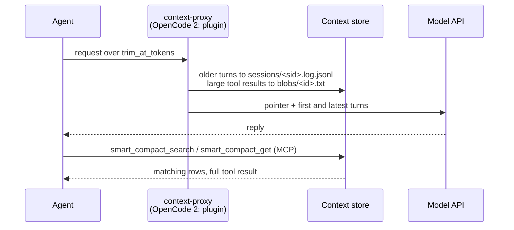

# Context management

Context management (smart compaction) keeps long coding-agent sessions under a token limit without an LLM summary. Older turns move to a local log; a pointer takes their place; the agent searches the log when it needs a detail back.

Each request goes through four steps ([context proxy](context-proxy.md) has the details):

| Step | When | Effect |
| --- | --- | --- |
| Tool-result compression | A tool result exceeds `compress_over_tokens` | First 40 and last 20 lines stay, behind a `smart_compact_get(id=...)` header; the full text goes to `blobs/<id>.txt` |
| Trim | The request reaches `trim_at_tokens`, or the user typed `/smart-compact` | Turns before the last real user turn go to `sessions/<sid>.log.jsonl`; a pointer replaces them. System prompt, tools, the first user turn and the in-flight turn stay verbatim |
| Recall on trim | The session registration names a bank | Memory recall for the last prompt follows the pointer, capped at `[compaction] max_chars`. Proxy: Hindsight only. OpenCode 2 plugin: any provider |
| Standing instruction | Every request | A constant system-prompt note tells the agent to call `smart_compact_search` before answering from content it cannot see |

The cut is sticky: later requests with the same history get the same rewrite byte for byte, so the prompt cache keeps hitting. A trim invalidates the cache once.

## When to turn it on

| Turn it on when | Leave it off when |
| --- | --- |
| Sessions grow past `trim_at_tokens` (default 120,000 estimated tokens) | Sessions stay under that limit |
| You want trimmed turns searchable instead of summarized away | You cannot run the `context-proxy` container (Claude Code and OpenCode 1 send every request to it and fail while it is down) |
| You use Claude Code or OpenCode | You use only Codex or Cursor CLI (neither is routed through the proxy) |

The thresholds are untuned defaults.

## Turn it on or off

| Where | On | Off |
| --- | --- | --- |
| Setup wizard | Step 8 "Context management (smart compaction)": answer yes | Answer no |
| CLI | `npx @bcmyguest/openmem context on` | `npx @bcmyguest/openmem context off` |
| Installer flag | `install-coding-agent --yes --context-proxy` | `install-coding-agent --yes --no-context-proxy` |
| Config key | `[context_proxy] enabled = true`, then `install-coding-agent --yes` | `enabled = false`, then `install-coding-agent --yes` |

All four write `[context_proxy] enabled` in `~/.config/personal-memory/config.toml`. The default is off.

- **Wizard.** The step's default is the saved value. On, it writes the proxy key file (`~/.config/personal-memory/context-proxy.env`, mode 600) and the store directories, then starts the service with the provider's compose profile plus `--profile context-proxy` (`up -d --no-build context-proxy`). Off, it stops a running `context-proxy` after the coding-agent step, unless Claude Code or OpenCode 1 still points at it. `--dry-run` prints the plan and writes nothing.
- **CLI.** `context on` starts the service, then re-runs `install-coding-agent --yes --context-proxy`. `context off` re-runs `install-coding-agent --yes --no-context-proxy`, then stops the service. Both take `--dry-run` and `--agents a,b`. `context status [--json]` prints the config value, whether the proxy answers on its port, and which agents point at it.
- **Installer.** Without a flag, `install-coding-agent` follows `[context_proxy] enabled`. A flag overrides the config and is saved. The installer does not start or stop the container.

`/smart-compact` in a session forces a trim on the next request.

## Agent support

From the [compatibility matrix](compatibility.md):

| Agent | Trim and compression | How | Evidence |
| --- | --- | --- | --- |
| Claude Code | ✅ | `context-proxy` through `ANTHROPIC_BASE_URL` in `~/.claude/settings.json` | Verified live with `claude -p` through LiteLLM v1.106.6; installer wiring test-covered only |
| Codex CLI | ❌ | Hooks only | LiteLLM forwards ChatGPT-login traffic only from v1.109.0-dev.1; no stable release |
| Cursor CLI | ❌ | Not wired | Custom model base URL support unverified |
| OpenCode 1.x | ◐ | `context-proxy` through `provider.anthropic.options` | Whether OpenCode applies the `headers` option to its built-in Anthropic provider is unverified |
| OpenCode 2.x | ✅ native | OpenMem's OpenCode 2 plugin trims in its `context` hook; never uses the proxy | Checked once live with OpenCode 2.2.1 against fake model and Hindsight servers |

OpenCode 2 differs in two ways:

- The plugin trims whatever `[context_proxy] enabled` says. `CONTEXT_PROXY_ENABLED=0` in OpenCode's environment turns its trim off.
- With `[compaction] native = true` (the default), the plugin also replaces OpenCode's own compaction summary with the pointer plus recall. No other agent has this.

## Tools agents use

Both tools are part of the unified `memory_*` MCP server, read local files only, and work with every memory provider.

| Tool | Input | Returns |
| --- | --- | --- |
| `smart_compact_search` | `query` (words) or `pattern` (JavaScript regex); optional `session_id` from the pointer, `context` (0-5 neighbouring rows), `limit` (default 8) | Matching rows of the handoff log with excerpts, `total_matches`, `line_matches`, `log_files`, and `blob_ids` for compressed results. Without `session_id`, recent sessions under the workspace's git root |
| `smart_compact_get` | `id` (16 hex characters), optional `offset` | Full text of a compressed tool result, at most 100,000 characters per call; page with `next_offset` |

The installer does not wire the unified MCP for OpenCode 2 ([compatibility](compatibility.md), footnote 1). The pointer names the handoff log path, so a shell-capable agent can search it with `rg`.

## Configuration

`~/.config/personal-memory/config.toml` (shipped example: `config/openmem.toml.example`). Environment variables override the file.

| Key | Default | Env override | Effect |
| --- | --- | --- | --- |
| `[context_proxy] enabled` | `false` | none (`CONTEXT_PROXY_ENABLED=0` turns trimming off inside the proxy and the OpenCode 2 plugin) | Point Claude Code and OpenCode 1 at the proxy |
| `[context_proxy] port` | `4100` | none (copied to the stack `.env` as `CONTEXT_PROXY_PORT`) | Host port, bound to 127.0.0.1 |
| `[context_proxy] trim_at_tokens` | `120000` | `CONTEXT_TRIM_AT_TOKENS` | Estimated request tokens (characters / 4) that trigger a trim |
| `[context_proxy] compress_over_tokens` | `4000` | `CONTEXT_COMPRESS_OVER_TOKENS` | Tool results above this are compressed; `0` disables compression |
| `[context_proxy] standing_instruction` | `true` | `CONTEXT_STANDING_INSTRUCTION` | Constant system-prompt note to search trimmed turns |
| `[compaction] max_chars` | `12000` | `CONTEXT_COMPACTION_MAX_CHARS` | Cap on recall text after a trim or compaction pointer |
| `[compaction] native` | `true` | none | OpenCode 2 only: replace OpenCode's compaction summary with the pointer plus recall |

`install-coding-agent` and `./setup` copy the trim keys into the stack `.env` the proxy container reads. The store lives at `$OPENMEM_STATE_DIR/context` (default `~/.local/share/openmem/context`).

## More

- [Context proxy](context-proxy.md): the compose service, its environment variables and limits.
- [Context store](context-store.md): file layout, session ids, trim rules and inserted text.
- [Context research](context-research.md).
