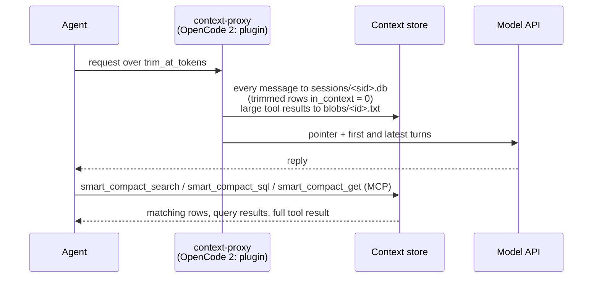

# Context management

Context management (smart compaction) keeps long coding-agent sessions under a token limit without an LLM summary. Every message goes into a local SQLite session store; older turns leave the context and the turn they precede carries a pointer to them; the agent searches the store when it needs a detail back.

<p align="center">
<picture>
<source media="(prefers-color-scheme: dark)" srcset="https://bcmyguest.github.io/openmem/media/smart-compaction-dark.gif" />

</picture>
<br />
<sub>Older turns move to the session store, the cut turn carries a pointer, and <code>smart_compact_search</code> pulls a detail back.</sub>
</p>



Each request goes through five steps ([context proxy](context-proxy.md) has the details):

| Step | When | Effect |
| --- | --- | --- |
| Tool-result compression | A tool result exceeds `compress_over_tokens` | First 40 and last 20 lines stay, behind a `smart_compact_get(id=...)` header; the full text goes to `blobs/<id>.txt` |
| Store | Every request | Each message goes into `sessions/<sid>.db` once, keyed by a chained fingerprint, with an `in_context` flag ([context store](context-store.md#session-database)) |
| Trim | The request reaches `trim_at_tokens`, or the user typed `/smart-compact` | Turns before the last real user turn, and the oldest tool exchanges of a long in-flight turn, leave the context and their rows get `in_context = 0`; a pointer naming `smart_compact_search` / `smart_compact_sql` replaces them. System prompt, tools, the first user turn, the reply before the last user turn, that turn and at least its last 3 tool exchanges stay verbatim, except that signed thinking leaves every kept assistant message but the latest ([why](context-store.md#trim)) |
| Recall on trim | The session registration names a bank and `[compaction] recall` is on | Memory recall for the last prompt follows the pointer in an `<openmem-recall untrusted="true">` block marked as reference data, not instructions, capped at `[compaction] max_chars`. Proxy: Hindsight only. OpenCode 2 plugin: any provider |
| Standing instruction | Every request | A constant system-prompt note tells the agent to call `smart_compact_search` before answering from content it cannot see, and that `<openmem-recall>` blocks are data, not instructions |

The cut is sticky: later requests with the same history get the same rewrite byte for byte, so the prompt cache keeps hitting. A trim invalidates the cache once.

## Benchmarks

ContextBench synthetic tasks, run through Claude Code in headless strict mode (no Bash or file tools, so the agent cannot park data on disk) with one model, Claude Haiku 5.5. Three settings: keep everything (no compaction), Claude Code's native auto-compaction, and OpenMem smart compaction (SQLite store, lexical search and `smart_compact_sql`). `kv-store` streams key-value batches and then asks for values; `log-triage` streams log batches and then asks lookup and count questions. Sizes grow left to right. Seed counts differ per cell (n in the table). [Context research](context-research.md#benchmark-method) has the method, every run and the caveats. The numbers and charts below are generated by `site/scripts/bench/compute-contextbench.py` and `site/scripts/bench/render-contextbench.mjs` from the result files.

<!-- contextbench:start (generated by site/scripts/bench/render-contextbench.mjs; do not edit) -->
<p align="center">
<picture>
<source media="(prefers-color-scheme: dark)" srcset="https://bcmyguest.github.io/openmem/media/contextbench-quality-dark.png" />

</picture>
</p>

Source: [ContextBench](https://github.com/RulinShao/ContextBench) synthetic tasks, Claude Haiku 5.5. Score is reward_lenient (tag-insensitive), the mean over the completed seeds of each cell. † a seed dropped the `#tag` from its kv answers and scored 0 under the strict reward; the values were right. ‡ the harness step limit stopped the trial before any question, so the 0 is not a recall score.

| Task, size | OpenMem smart compaction | Native compaction | Keep everything |
| --- | --- | --- | --- |
| kv-store R1000 | 1.00, n = 3 | 1.00, n = 1 | 1.00, n = 1 |
| kv-store R4000 | 1.00 †, n = 3 | 0.04, n = 1 | 1.00, n = 2 |
| kv-store R16000 | 1.00 †, n = 3 | 0.00, n = 1 | 0.00 ‡, n = 2 |
| log-triage L1600 | 0.90 (lookup 1.00, count 0.81), n = 3 | 0.50 (lookup 1.00, count 0.00), n = 1 | 0.71 (lookup 1.00, count 0.42), n = 1 |
| log-triage L6400 | 1.00 (lookup 1.00, count 1.00), n = 3 | 0.08 (lookup 0.17, count 0.00), n = 2 | 0.46 (lookup 0.92, count 0.00), n = 2 |
| log-triage L12800 | 1.00 (lookup 1.00, count 1.00), n = 3 | no completed trial | 0.38 (lookup 0.75, count 0.00), n = 1 |

### Time

<p align="center">
<picture>
<source media="(prefers-color-scheme: dark)" srcset="https://bcmyguest.github.io/openmem/media/contextbench-compaction-dark.png" />

</picture>
</p>

Native compaction is a model call. Claude Code's summary call took median 10.7 s (p10–p90 7.6–16.1 s, n = 22); Claude Code's own compaction timer read median 12.4 s (p10–p90 9.1–17.7 s, n = 22). The summary calls are the requests after which the next prompt drops below half its size; that finds 22 of the 22 compactions Claude Code reported.

Smart compaction makes no model call: the proxy cuts the history in its pre-call hook and records no separate hook time. The request that carried a trim took median 4.0 s (p10–p90 3.1–5.4 s, n = 81), against median 1.7 s (p10–p90 1.4–2.5 s, n = 2723) for the other requests of the same run. That request also rewrites the prompt cache for the shortened history, so the difference is an upper bound on the trim's own time, assuming LiteLLM's request timer covers the pre-call hook (not verified).

<p align="center">
<picture>
<source media="(prefers-color-scheme: dark)" srcset="https://bcmyguest.github.io/openmem/media/contextbench-time-dark.png" />

</picture>
</p>

| Setting | Trials | Agent wall time per trial, mean | Requests | Request latency, mean | Prompt-cache hit rate |
| --- | --- | --- | --- | --- | --- |
| OpenMem smart compaction | 18 | 12.3 min | 2804 | 1.99 s | 95% |
| Native compaction | 6 | 8.1 min | 729 | 0.86 s | 93% |
| Keep everything | 9 | 9.7 min | 1077 | 0.59 s | 99% |

Wall time per trial is longer with OpenMem (593 s vs 472 s for native compaction); OpenMem also makes more requests per trial (130 vs 117), which include its store searches.

Source: [ContextBench](https://github.com/RulinShao/ContextBench) synthetic tasks, Claude Haiku 5.5.

Wall time and request latency come from different runs: the baselines (run B) and smart compaction (run D) used different LiteLLM builds, ran at different times under different API load, and only run D had the OpenMem hook. Treat the comparison as rough.

### Cost and prompt cache

<p align="center">
<picture>
<source media="(prefers-color-scheme: dark)" srcset="https://bcmyguest.github.io/openmem/media/contextbench-cost-dark.png" />

</picture>
</p>

<p align="center">
<picture>
<source media="(prefers-color-scheme: dark)" srcset="https://bcmyguest.github.io/openmem/media/contextbench-cache-dark.png" />

</picture>
</p>

Source: [ContextBench](https://github.com/RulinShao/ContextBench) synthetic tasks. Cost applies Claude Haiku 5.5 list prices to each request’s token counts. Cache hit rate is cache reads over all prompt tokens (input, cache reads and cache writes) of a cell’s requests. Peak prompt is the largest single request.

| Task, size | List-price cost per trial (smart / native / keep) | Prompt-cache hit rate (smart / native / keep) | Tokens per trial, cache reads in parentheses (smart / native / keep) | Peak prompt (smart / native / keep) |
| --- | --- | --- | --- | --- |
| kv-store R1000 | $0.05 / $0.05 / $0.05 | 97% / 97% / 97% | 2.9M (2.8M) / 2.8M (2.7M) / 2.8M (2.7M) | 101k / 97k / 96k |
| kv-store R4000 | $0.22 / $0.24 / $1.05 | 93% / 88% / 98% | 5.0M (4.6M) / 3.4M (3.0M) / 15.8M (15.4M) | 119k / 120k / 358k |
| kv-store R16000 | $0.85 / $0.88 / $3.64 | 90% / 88% / 98% | 13.8M (12.4M) / 12.8M (11.2M) / 56.0M (55.0M) | 119k / 119k / 979k |
| log-triage L1600 | $0.27 / $0.31 / $0.57 | 98% / 99% / 98% | 9.0M (8.9M) / 8.6M (8.4M) / 10.2M (9.9M) | 120k / 120k / 178k |
| log-triage L6400 | $0.32 / $0.36 / $1.88 | 96% / 95% / 99% | 10.6M (10.2M) / 8.7M (8.2M) / 32.6M (32.2M) | 120k / 123k / 386k |
| log-triage L12800 | $0.74 / — / $6.12 | 96% / — / 99% | 18.6M (17.7M) / — / 109.4M (108.6M) | 120k / — / 765k |
<!-- contextbench:end -->

### Latest version: search-tools note and cache-stable trims

The charts and tables above are run D. Three changes since, measured on one task (log-triage L1600 seed 44):

1. **Haiku trims at 95k** instead of about 120k, so every request stays under the 100k line where list prices rise 5× per token.
2. **The trim note names the search tools.** Without it the model never searched its trimmed history on this task and answered 16 of 24 questions UNKNOWN. With it, every trial searched and answered every question.
3. **Trims keep the prompt cache intact.** A trim now drops the model's thinking from before the cut and keeps the thinking after it. The start of the prompt stays identical from one request to the next, so the cache keeps hitting.

| Version | Trials | Score | Cost per trial | Cache hit rate | Tokens written to cache | Largest prompt | Wall time |
| --- | --- | --- | --- | --- | --- | --- | --- |
| 95k trim | 1 | 0.17 | $0.15 | 93% | 404k | 94k | 7.9 min |
| + search-tools note | 5 | 0.94 | $0.22 | 92% | 598k | 95k | 9.8 min |
| + cache-stable trims | 5 | 1.00 | $0.11 | 98% | 163k | 95k | 7.3 min |

The cache fix halves mean cost, and all 5 trials scored 1.00. Most of the gap is one search-tools-only trial that trimmed 3 times, wrote 2.2M tokens to the cache and cost $0.59; without it that version averages $0.13.

For scale, the same size on seed 42 (one trial each, a different task instance): keep everything scored 0.71 at $0.57 with a 178k largest prompt; native compaction scored 0.50 at $0.31. The latest version costs about a fifth of keep everything and a third of native compaction. Most of that saving is the price tier, not token count: total tokens differ by less than 1.5× (6.9M against 10.2M). Treat the ratios as rough until the baselines run on seed 44. [Context research](context-research.md) has every trial.

### Compact-Bench (real coding sessions)

[Compact-Bench](https://github.com/cai-jianfeng/compact-bench)'s Task Preservation track resumes real SWE-bench repair sessions after compaction and checks whether the task is preserved, damaged, rescued or left unsolved, per method: full history, Claude Code summary, Codex summary and OpenMem.

<!-- compact-bench:start (generated by site/scripts/bench/render-contextbench.mjs; do not edit) -->
Compact-Bench results pending. The run is in progress; partial numbers are not published. Methods: Full history, Claude Code summary, Codex summary, OpenMem.
<!-- compact-bench:end -->

## When to turn it on

| Turn it on when | Leave it off when |
| --- | --- |
| Sessions grow past `trim_at_tokens` (default 120,000 estimated tokens, 95,000 for Haiku) | Sessions stay under that limit |
| You want trimmed turns searchable instead of summarized away | You cannot run the `context-proxy` container (Claude Code, OpenCode 1 and Codex send every request to it and fail while it is down) |
| You use Claude Code, Codex or OpenCode (OpenCode 2 needs no container) | You use only Cursor CLI (not routed through the proxy) |

The thresholds are untuned defaults.

## Turn it on or off

The switch is per agent. `[context_proxy.agents]` holds one key per agent; a missing key follows the master switch `[context_proxy] enabled`. With neither set, OpenCode 2 is on (it needs no service) and the proxy-routed agents are off.

```toml
[context_proxy]
enabled = true            # master switch
[context_proxy.agents]    # optional overrides; missing = follow `enabled` (unset: opencode2 on, others off)
claude-code = true
opencode1   = true
codex       = false
opencode2   = true        # native plugin, no service
```

| Key | Served by | Needs the `context-proxy` service |
| --- | --- | --- |
| `claude-code` | `context-proxy` | yes |
| `opencode1` | `context-proxy` | yes |
| `opencode2` | OpenMem's OpenCode 2 plugin | no |
| `codex` | `context-proxy` service, ChatGPT login kept (`/backend-api/codex`) | yes |

| Where | How |
| --- | --- |
| Setup wizard | Step 8 "Context management (smart compaction)": tick the installed agents to trim |
| CLI | `npx @bcmyguest/openmem context on [--agents a,b]` / `context off [--agents a,b]`; without `--agents`, all four |
| Config | Edit the keys above, then `install-coding-agent --yes` |
| Installer flag | `install-coding-agent --yes --context-proxy` / `--no-context-proxy`: every agent on or off for this run; saves `enabled` |

- **Wizard.** The step offers Claude Code, OpenCode 1, Codex and OpenCode 2 when installed. Each default is the saved key, else a saved `enabled`, else on for OpenCode 2 and off for the proxy-routed agents. The step saves all four keys and sets `enabled` to whether any is on. When a proxy-routed agent is on, it writes the proxy key file (`~/.config/personal-memory/context-proxy.env`, mode 600) and the store directories, then starts the service with the provider's compose profile plus `--profile context-proxy` (`up -d --no-build context-proxy`). When none is, it stops a running `context-proxy` after the coding-agent step, unless Claude Code, OpenCode 1 or Codex still points at it. `--dry-run` prints the plan and writes nothing.
- **CLI.** `context on|off` sets the named agents, keeps the others at their current value, sets `enabled` to whether any agent is on, and re-runs `install-coding-agent --yes`. `--dry-run` prints the save and runs the installer with `--dry-run`, which plans from the saved config. `context status [--json]` lists each agent (on/off, saved, following `enabled`, or default; how it is served), whether the proxy answers on its port, and which agents point at it. It then summarizes the last 24 hours of [events](context-store.md#events) from the session store, without docker: trims, estimated tokens saved, messages dropped, fail-opens (request sent untrimmed) with the newest five errors, the prompt cache from `usage` events (requests, how many reported cache counts, hit ratio = cache read / (read + creation + uncached input) over those requests, cache-creation tokens on requests that made a new cut vs the rest with their averages, and, for the proxy's Anthropic route, the `cache_control` breakpoint count distribution and the five most common layouts), and whether the proxy code in the last event matches the checkout (restart the service when it does not).
- **Installer.** Without a flag, `install-coding-agent` points Claude Code and OpenCode 1 at the proxy according to their keys. When the stack root has a `compose.yaml`, it also starts the service (before pointing agents at it) if `claude-code` or `opencode1` is on, and stops a running service (after unpointing them) if neither is, unless an agent still points at it.
- **OpenCode 2.** The plugin reads `opencode2`, else `enabled`, else trims (no service needed), when OpenCode starts it. An explicit `opencode2 = false`, or `enabled = false` without an `opencode2` key, turns it off. `CONTEXT_PROXY_ENABLED` in OpenCode's environment overrides the config: `0` turns the trim off, `1` on.

`/smart-compact` in a session forces a trim on the next request.

## Agent support

From the [compatibility matrix](compatibility.md):

| Agent | Trim and compression | How | Evidence |
| --- | --- | --- | --- |
| Claude Code | ✅ | `context-proxy` through `ANTHROPIC_BASE_URL` in `~/.claude/settings.json` | Verified live with `claude -p` through LiteLLM v1.106.6; installer wiring test-covered only |
| Codex CLI | ✅ | `context-proxy` through `model_provider = "openmem"` and `[model_providers.openmem]` in `~/.codex/config.toml` | Verified live once with `codex exec` (ChatGPT login) through LiteLLM v1.109.0-dev.1, the only release with the subscription pass-through; installer wiring test-covered only ([footnote 9](compatibility.md#coding-agents)) |
| Cursor CLI | ❌ | Not wired | Custom model base URL support unverified |
| OpenCode 1.x | ◐ | `context-proxy` through `provider.anthropic.options` | Whether OpenCode applies the `headers` option to its built-in Anthropic provider is unverified |
| OpenCode 2.x | ✅ native | OpenMem's OpenCode 2 plugin trims in its `context` hook; never uses the proxy | Checked once live with OpenCode 2.2.1 against fake model and Hindsight servers |

OpenCode 2 differs in two ways:

- The plugin trims in-process, so its `opencode2` key needs no service.
- With `[compaction] native = true` (the default), the plugin also replaces OpenCode's own compaction summary with the pointer plus recall. No other agent has this.

Claude Code keeps its own auto-compact on as a safety net: if the proxy is down, nothing else bounds the session. The two overlap. Claude Code counts tokens over its full local transcript, not the trimmed request the proxy sends, so `/context` reads higher than the API's reported usage and Claude Code can compact a session the proxy has already trimmed. Each such compaction starts a new thread in the trim state, and the proxy trims it afresh.

## Tools agents use

All four tools are part of the unified `memory_*` MCP server, read local files only, and work with every memory provider.

| Tool | Input | Returns |
| --- | --- | --- |
| `smart_compact_search` | `query` (words, FTS5) or `pattern` (JavaScript regex); optional `session_id` from the pointer, `role` (`user`, `assistant`, `tool`, a list, or `all`; default user and tool), `in_context` (`true` rows still in context, `false` trimmed rows; default both), `mode` (`hybrid` or `lexical`), `context` (0-5 neighbouring rows), `limit` (default 8) | Matching rows of the session database (`seq`, `role`, `kind`, `in_context`, excerpt), `total_matches`, `line_matches` (exact count of matching lines in the `lines` table across the session, under the same filters), `databases`, and `blob_ids` for compressed results. Without `session_id`, recent sessions under the workspace's git root |
| `smart_compact_sql` | `session_id`, `sql` (one read-only `SELECT` or `WITH … SELECT`) | At most 200 rows over `messages`, `lines`, `messages_fts`, `lines_fts`, `events`; 2 s limit. For counts, groupings and joins ([context store](context-store.md#sql)) |
| `smart_compact_get` | `id` (16 hex characters), optional `offset` | Full text of a compressed tool result, at most 100,000 characters per call; page with `next_offset` |
| `context_status` | optional `hours` (1-720, default 24) | The `context status` events summary: `trims`, `tokensSaved` (estimated), `failOpens`, `lastErrors`, `latest` writer versions, `checkout_proxy_version` and `proxy_stale` (`null` where the checkout has no `proxy/`, as in the installed agent runtime), and `usage`: `requests`, `withCacheCounts`, token sums, `hitRatio` (`null` without cache counts), `newCut` / `other` cache-creation totals, `breakpoints` (count to requests) and `breakpointLayouts` |

The installer does not wire the unified MCP for OpenCode 2 ([compatibility](compatibility.md), footnote 1). The pointer names no file path; a shell-capable agent can query `sessions/<sid>.db` under the store root with `sqlite3`.

## Configuration

`~/.config/personal-memory/config.toml` (shipped example: `config/openmem.toml.example`). Environment variables override the file.

| Key | Default | Env override | Effect |
| --- | --- | --- | --- |
| `[context_proxy] enabled` | unset | none | Master switch: the value of every agent key that is not set. Unset: `opencode2` on, the others off |
| `[context_proxy.agents] claude-code`, `opencode1`, `codex`, `opencode2` | follow `enabled`; with it unset, `opencode2` on and the others off | `CONTEXT_PROXY_ENABLED` for `opencode2` (in OpenCode's environment) | Per-agent on/off; see [Turn it on or off](#turn-it-on-or-off) |
| `[context_proxy] port` | `4100` | none (copied to the stack `.env` as `CONTEXT_PROXY_PORT`) | Host port, bound to 127.0.0.1 |
| `[context_proxy] trim_at_tokens` | `95000` for Haiku, `120000` otherwise | `CONTEXT_TRIM_AT_TOKENS` | Estimated prompt tokens that trigger a trim; unset, the threshold follows the request's model ([settings](context-proxy.md)), and a set value applies to every model; the estimate is calibrated from the provider's reported usage ([token estimate](context-proxy.md#token-estimate)) |
| `[context_proxy] trim_to_fraction` | `0.3` | `CONTEXT_TRIM_TO_FRACTION` | How deep a trim cuts a long in-flight turn: older tool exchanges stay only while the request is under this fraction of `trim_at_tokens`. Between 0 and 1; another value falls back to 0.3 |
| `[context_proxy] chars_per_token` | `2.5` | `CONTEXT_CHARS_PER_TOKEN` | Characters per token before a session reports usage |
| `[context_proxy] compress_over_tokens` | `4000` | `CONTEXT_COMPRESS_OVER_TOKENS` | Tool results above this are compressed; `0` disables compression |
| `[context_proxy] standing_instruction` | `true` | `CONTEXT_STANDING_INSTRUCTION` | Constant system-prompt note to search trimmed turns |
| `[compaction] max_chars` | `12000` | `CONTEXT_COMPACTION_MAX_CHARS` | Cap on the recall block (frame included) after a trim or compaction pointer |
| `[compaction] recall` | `true` | `CONTEXT_COMPACTION_RECALL` | Recall in the trim or compaction pointer |
| `[compaction] native` | `true` | none | OpenCode 2 only: replace OpenCode's compaction summary with the pointer plus recall |
| `[context_store] ttl_days` | `30` | `CONTEXT_STORE_TTL_DAYS` | Delete sessions idle longer than this; `0` keeps everything |
| `[context_store] embedding_model` | empty (off) | `CONTEXT_EMBEDDING_MODEL` | Embedding model for hybrid `smart_compact_search` ([vectors](context-store.md#vectors)) |
| `[context_store] embedding_url` | `http://127.0.0.1:11434/v1` | `CONTEXT_EMBEDDING_URL` | OpenAI-compatible embeddings endpoint as the host sees it |
| `[context_store] embedding_timeout_s` | `30` | `CONTEXT_EMBEDDING_TIMEOUT_S` | Seconds per row of a background embeddings call |
| `[context_store] embedding_max_chars` | `4000` | `CONTEXT_EMBEDDING_MAX_CHARS` | Characters of each row's head that are embedded |

`install-coding-agent` and `./setup` copy the trim keys into the stack `.env` the proxy container reads. The store lives at `$OPENMEM_STATE_DIR/context` (default `~/.local/share/openmem/context`).

## More

- [Context proxy](context-proxy.md): the compose service, its environment variables and limits.
- [Context store](context-store.md): file layout, session database schema, search and SQL tools, trim rules and inserted text.
- [Context research](context-research.md).
