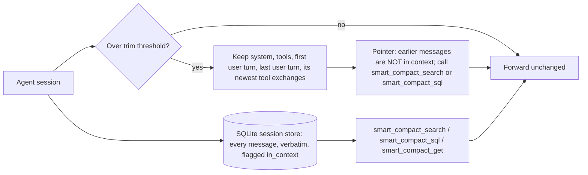

# Context research and evidence

Why the [context proxy](context-proxy.md) trims the way it does, which published work shaped it, and what our own benchmark runs show. Results are interim, dated 2026-10-30; run D is complete, runs B and C are partial.

## Problem

Long agent sessions outgrow the context window. Agents handle this in one of three ways, and each fails differently:

| Approach | Failure |
| --- | --- |
| Keep everything | The prompt grows until the window fills, and accuracy drops as input grows ("context rot", below). In our runs a kv-store session reached 979k tokens and never answered. |
| Native auto-compaction (LLM summary) | The summary keeps the gist but drops exact values. In our strict run it scored 0.049. |
| Trim + pointer + search (this proxy) | The agent must remember to search. Before the standing instruction, 2 of 12 trials never searched. |

## Related work

| Work | Approach | What we took | How we differ |
| --- | --- | --- | --- |
| [MemGPT](https://arxiv.org/abs/2310.08560) (Packer et al., 2023) | OS-style virtual context: a small main context plus searchable recall storage, paged in by function calls. | Verbatim recall storage behind search tools instead of a summary. | No self-editing memory; the proxy trims and the agent only searches. |
| [MemGPT DMR](https://arxiv.org/abs/2310.08560) (Table 2) and [MSC-Self-Instruct](https://huggingface.co/datasets/MemGPT/MSC-Self-Instruct) | Deep memory retrieval questions over earlier Multi-Session Chat sessions. GPT-4 scored 32.1% fixed-context and 92.5% with MemGPT; GPT-4 Turbo scored 35.3% and 93.4%. | Evidence that search over stored turns beats a fixed window. | Its conversations fit in today's windows, so it doesn't force trimming. Not run here. |
| MemGPT nested key-value retrieval (same paper) | Multi-hop lookups across key-value pairs. Fixed-context GPT-4 and GPT-4 Turbo reach 0% by 3 nesting levels; MemGPT with GPT-4 is unaffected by nesting depth. | Closest published analogue to our kv-store task. | Not run here. |
| [The Complexity Trap](https://arxiv.org/html/2508.21433v3) (Lindenbauer et al., JetBrains Research, 2025) | SWE-agent on SWE-bench Verified: observation masking (replace old tool outputs with a placeholder, keep the last 10) against LLM summarization. Masking roughly halves cost against the raw agent and matches summarization's solve rate; Qwen3-Coder 480B scored 54.8% at $0.61 masked, 53.8% at $0.64 summarized, 53.4% at $1.29 raw. | Evidence that removal without an LLM summary is a sound default. | Masking drops only observations and keeps the agent's reasoning and actions; we drop whole turns but keep them searchable. |
| [Letta: Is a Filesystem All You Need?](https://www.letta.com/blog/benchmarking-ai-agent-memory/) (2025-08-12) | Conversation history stored as files; agent uses `grep`, `search_files`, `open`, `close`. 74.0% on LoCoMo with GPT-4o mini, against 68.5% for Mem0's best graph variant. | File-like tools (search, open) work well; models already use them iteratively. | Letta's files are server-side and reached through tools. We copy that: the store is reached through MCP tools, not a shell. |
| [Mainplane](https://github.com/mainplane-ai/mainplane) | Each session is one append-only state file. `/continue` starts a new session with "You are continuing session X. Retrieve key context from it as you go." A standing "Context Management" system-prompt section says the previous session's log "is searchable with rg". | The pointer-and-retrieve continuation, and a standing system instruction telling the agent the content exists and how to fetch it. | We trim in place, keeping the same session and prompt-cache prefix, instead of starting a new session. Access is through tools, not `rg`. |
| [rtk](https://github.com/rtk-ai/rtk) | "CLI proxy that reduces LLM token consumption by 60-90% on common dev commands"; an optional `rtk-proxy` compresses provider-API payloads. | Compress large tool output before the model reads it; `install-coding-agent` runs `rtk init` when rtk is installed. | Our compression keeps the full text as a blob behind `smart_compact_get`, so nothing is lost. |
| [Anthropic: Effective context engineering](https://www.anthropic.com/engineering/effective-context-engineering-for-ai-agents) (2025-09-29) | "Just in time" retrieval: agents "maintain lightweight identifiers (file paths, stored queries, web links, etc.)" and load data with tools; compaction; structured note-taking. | The pointer is a lightweight identifier; the store is loaded just in time. | Anthropic's compaction writes a summary; ours stores the removed turns verbatim. |
| [Anthropic context editing and memory tool](https://claude.com/blog/context-management) (2025-09-29) | Server-side clearing of stale tool results, plus a client-side memory directory. Internal agentic-search eval: context editing +29%, with the memory tool +39%; 84% fewer tokens in a 100-turn web-search eval. | Clearing old content without a summary helps; saving it first helps more. | We work through any provider via LiteLLM, and the removed content stays searchable. |
| [Manus: Context engineering](https://agentic-ai.readthedocs.io/en/latest/ContextEngineering/manus/) | The file system as "the ultimate context"; every compression is "restorable" because the path or URL stays. | Restorable compression: every trimmed block and compressed result keeps an id the agent can fetch. | Same principle, applied in a proxy rather than in the agent. |
| [Chroma: Context Rot](https://www.trychroma.com/research/context-rot) (2025-07-14) and [repo](https://github.com/chroma-core/context-rot) | 18 models (GPT-4.1, Claude 4, Gemini 2.5, Qwen3). Accuracy falls as input grows, more for semantic than lexical needle matches. On LongMemEval, a ~300-token focused prompt beat a ~113k-token full prompt. | The goal: keep the active context small. Exact-match search plays to what models still do well. | Its tests are single prompts, not agent sessions. |
| [LongMemEval](https://arxiv.org/abs/2410.10813) | 500 questions over chat histories of ~115k tokens (S) or ~1.5M tokens (M); five memory abilities. | Candidate benchmark for paraphrase and semantic recall. | Not run yet. |
| [LoCoMo](https://arxiv.org/abs/2402.17753) ([data](https://github.com/snap-research/locomo)) | 50 dialogues, ~300 turns and ~9k tokens each, up to 35 sessions. | Used by Letta's result above. | Too short to force trimming. |
| [ContextBench](https://github.com/RulinShao/ContextBench) (from [Context Language Models](https://github.com/facebookresearch/context-language-models)) | Measures what an agent keeps, updates and offloads when input exceeds its window. Families: kv-store, log-triage, needle-retention, sudoku-sketchpad. Graded from the agent's own messages, not disk. Runs on Harbor. | Our benchmark harness and tasks. | We add a strict mode (below). |
| [opencode-clm](https://github.com/bcmyguest/opencode-clm) (port of [pi-clm](https://github.com/lolipopshock/pi-clm)) | OpenCode 1 and 2 plugin for Context Language Models. Before each request it writes the conversation to `LIVE_CONTEXT.md`; the model edits that file with bash (`sed -i`, python3), and the edited file becomes its next context. An edit gate refuses growth past the budget; an overflow guard swaps the oldest tool results for notes pointing at `withheld/` files. | Same goal as the proxy: keep the active context under a budget without an LLM summary, and keep removed text recoverable. | The model edits its own context; ours is trimmed by the proxy or plugin and searched with tools. Both register OpenCode 2 `context` and `compaction` hooks, so running both rewrites the same request; that combination is untested. |
| [Hindsight](https://github.com/vectorize-io/hindsight) | OpenMem's reference memory provider. | Recall on trim and, in run C, semantic search. | Provider recall alone (run C's s3d smoke test) found nearby keys rather than exact ones. |

## Design decisions and their evidence

| Decision | Evidence |
| --- | --- |
| Store removed turns verbatim and point to them instead of summarizing | Native summary scored 0.049 in the strict run against 0.750 for smart compaction; MemGPT and Letta show search over stored turns works. |
| Standing system instruction plus a firmer pointer ("NOT in your context. You MUST call smart_compact_search…") | Mainplane's pattern. Trials with zero searches fell from 2 of 12 (strict) to 0 of 12 (run A). |
| Pin the first user turn | Without it, a trim dropped the task statement itself. |
| Sticky, fingerprinted cut | Later requests get the same bytes, so the prompt cache keeps hitting after a trim. Smart compaction cost $0.84 per trial in the strict run against $1.46 for keep-everything; that gap mixes cache hits with smaller prompts. |
| Calibrate the token estimate from provider-reported usage | chars/4 underestimated these streams (about 2.3 characters per token), so a 120k threshold fired at 203–236k real tokens. Built: each thread's reported usage calibrates the estimate, with `chars_per_token` (2.5) before the first report ([token estimate](context-proxy.md#token-estimate)). In run D all 162 trims fired at 116.5–120.1k real tokens. |
| SQLite store: messages, lines, FTS5, hybrid ranking, read-only SQL tool | Built ([context store](context-store.md#session-database)). Run D: lookup 1.00 in all 18 log-triage trials, count 0.94 (d-sqlite) against 0 for every setting in the strict run. Letta shows file-like tools work, but shell-only access limits retrieval to coding agents; MCP tools reach any agent. `sessions/<sid>.db` holds every message, in context or trimmed; `smart_compact_search` filters by `role` and `in_context`, and `smart_compact_sql` answers counts and aggregates. Its `lines` table gives exact counts, which the old log-based `line_matches` could not. |
| Semantic search through the memory provider | Being measured in run C (s3c-semantic-nudged, s3d-recall). |
| Hybrid (vector) ranking in the session store | Unmeasured: in run D's d-hybrid the agent never ran a hybrid search. |

## Benchmark method

| Item | Setting |
| --- | --- |
| Harness | Harbor running ContextBench tasks through Claude Code (2.1.312) in headless mode |
| Model | Claude Haiku 5.5 through LiteLLM v1.106.6 (run D: v1.109.0-dev.1, the context-proxy pin) |
| Tasks | `kv-store` (stream SET batches, then GETs) and `log-triage` (log batches, then lookup and count questions); sizes R1000/R4000/R16000 and L1600/L6400/L12800 |
| Strict mode | Bash and file tools disabled. The first pilot scored 1.0 on every arm because the agent wrote values to a file in `/tmp` and grepped them back, so it measured the disk, not the context. |
| Settings (arms) | `s1-none` keep everything; `s2-native` Claude Code auto-compaction; `s3a-smart` proxy trim + search tools; `s3b-smart-nocomp` the same without tool-result compression; run C adds `s3c-semantic-nudged` and `s3d-recall`; run D's `d-sqlite` and `d-hybrid` are below |
| Proxy settings | trim at 120,000 estimated tokens, compress tool results over 4,000 |
| Scoring | `reward` is ContextBench's score. kv answers must include a random `#hex` tag that Haiku often drops; `reward_lenient` also accepts an otherwise-correct answer without the tag. A trial that dropped the tag was rerun once. |
| Concurrency | 8 trials at once in the strict run, at most 4 in runs A–D |

## Results (interim, 2026-10-29 to 2026-10-30)

### Strict run (complete; 24 trials, kv-store-R4000 and log-triage-L6400, seeds 42–44)

| Setting | reward | reward_lenient | $ per trial | Peak prompt | Native compactions | Trims | Searches per trial |
| --- | --- | --- | --- | --- | --- | --- | --- |
| s1 keep everything | 0.562 | 0.729 | 1.46 | 371k | 0 | 0 | — |
| s2 native | 0.049 | 0.049 | 0.47 | 121k | 3.7 | 0 | — |
| s3a smart | 0.750 | 0.750 | 0.84 | 214k | 0 | 1.5 | 12.7 |
| s3b smart, no compression | 0.611 | 0.611 | 0.85 | 220k | 0 | 1.0 | 7.3 |

No tool result crossed the 4,000-token threshold, so compression never ran and s3a and s3b were the same configuration; their gap is run-to-run variance. The count half of log-triage scored 0 in every setting.

### Run A: standing instruction and `line_matches` (first attempts complete; two tag-drop reruns pending)

Same tasks and seeds as the strict run, s3a and s3b only.

| Metric (s3a + s3b, 12 trials) | Strict run | Run A |
| --- | --- | --- |
| Trials with zero searches | 2 | **0** |
| kv-store reward_lenient, mean | 0.91 | **1.00** |
| log-triage lookup, mean | 0.90 | **1.00** |
| log-triage count, mean | 0 | 0.07 |
| log-triage reward, mean | 0.45 | **0.53** |

Run A used the earlier JSONL handoff log. Its `line_matches` counted only rows already trimmed into the log, so counts missed lines still in context (348 returned against a true 594), shifted between trims (111, then 184, against 171) and sometimes overcounted. The SQLite store replaces that log: `line_matches` now counts the `lines` table across the whole session, and `smart_compact_sql` answers counts directly. Run D benchmarks both.

### Run B: score against size (partial; mostly seed 42)

| Task, size | s1 keep everything | s2 native | s3a smart |
| --- | --- | --- | --- |
| kv R1000 | 1.00 (96k) | 1.00 (97k) | 1.00 (98k) |
| kv R4000 | 1.00 (358k) | 0.04 (120k) | 1.00 (204k) |
| kv R16000 | 0.00, hit step limit at 979k | 0.00 (119k, 12 compactions) | 1.00 (204k) |
| log L1600 | 0.71 (lookup 1.00, count 0.42; 178k) | 0.50 (lookup 1.00, count 0; 120k) | 0.50 (lookup 1.00, count 0; 157k, no trim) |
| log L6400 | 0.42 (lookup 0.83, count 0; 386k) | 0.13 (lookup 0.25; 121k) | **0.63** (lookup 0.92, count 0.33; 234k) |

Peak prompt tokens in parentheses. Keep-everything loses lookups and counts as the log grows (context rot); smart compaction holds lookups with a prompt about 40% smaller.

### Run D (SQLite store, calibrated trim; complete, 36 trials)

Run 2026-10-29 to 2026-10-30. Strict mode, Haiku 5.5, trim at 120,000 tokens (calibrated estimate), tasks kv-store R1000/R4000/R16000 and log-triage L1600/L6400/L12800, seeds 42/43/44.

| Setting | Code | Store and search |
| --- | --- | --- |
| `d-sqlite` | commit 4dded1d | `sessions/<sid>.db`, lexical search and `smart_compact_sql`; no vectors |
| `d-hybrid` | commit 2ec584e (adaptive embedding batches) | the same plus vectors from `nomic-embed-text` through Ollama on an iGPU |

Scores are tag-insensitive (`reward_lenient`). † marks a kv trial whose strict `reward` was 0 because every answer dropped the `#tag`; the values were right. Six first attempts (d-sqlite kv R4000 s43, R16000 s43 and s44; d-hybrid kv R1000 s42–s44) were moved to `invalid/` and rerun once; four of the six reruns dropped the tag again.

| Task | d-sqlite s42 / s43 / s44 | d-hybrid s42 / s43 / s44 | Trims | Peak prompt |
| --- | --- | --- | --- | --- |
| kv R1000 | 1.00 / 1.00 / 1.00 | 1.00 / 1.00† / 1.00† | 0 | 99–101k |
| kv R4000 | 1.00 / 1.00† / 1.00 | 1.00 / 1.00 / 1.00 | 3 | 119k |
| kv R16000 | 1.00 / 1.00 / 1.00† | 1.00 / 1.00 / 1.00 | 13 | 119k |
| log L1600 | 0.96 / 1.00 / 0.75 | 0.96 / 0.92 / 1.00 | 1 | 117–120k |
| log L6400 | 1.00 / 1.00 / 1.00 | 1.00 / 0.67 / 1.00 | 3 | 118–120k |
| log L12800 | 1.00 / 1.00 / 1.00 | 1.00 / 0.54 / 1.00 | 7 | 118–120k |

| Mean (18 trials per setting) | d-sqlite | d-hybrid |
| --- | --- | --- |
| All tasks, `reward_lenient` | 0.984 | 0.949 |
| All tasks, strict `reward` | 0.873 | 0.838 |
| kv-store, `reward_lenient` | 1.000 | 1.000 |
| log-triage lookup | 1.000 | 1.000 |
| log-triage count | 0.935 | 0.796 |

All 162 trims fired at 116,539–120,079 real prompt tokens, against 203–236k under the old chars/4 estimate. The largest prompt in any trial was 120,079 tokens. kv R1000 never reached the threshold.

Lookups were perfect. Every lost point is a count question, in six trials. Two failure modes explain four of them; both are known and not yet fixed:

- **Echo overcount.** `smart_compact_sql` counts the session's lines, and those include the agent's own tool output and answers, which repeat log lines. The repeats are counted again, giving overcounts of +1 to +8: d-sqlite L1600 s44 (count 0.50), d-hybrid L1600 s43 (0.83) and L12800 s43 (0.08).
- **No SQL.** On some count questions the agent answered without calling SQL: d-hybrid L6400 s43 used SQL on 6 of 12 count questions and scored 0.33.

The single missed count in L1600 s42 is the same question in both settings (gold 46, answer 45). The question is scoped narrower than all matching lines: the agent's first SQL count over every user line returned 174, and its follow-up queries grouped matches by message (the pinned first user turn holds 2). Its final answer was one short; which scoping step went wrong is not confirmed.

The agent never ran a hybrid search. All 337 `smart_compact_search` calls across both settings ran lexical, using exact `pattern`s or lexical queries for exact ids, and counts went through 307 `smart_compact_sql` calls. Run D therefore does not measure vectors, and d-hybrid's lower count mean comes from the failures above, not from embedding. The single-thread embedder also lagged under 4 concurrent sessions: at the end of the run 6 of the 15 trimmed d-hybrid databases had a vector for every row and the other 9 had none.

Cost at list price: $16.60 for run D, $9.12 for d-sqlite and $7.48 for d-hybrid (about $0.51 and $0.42 per trial).

Against run B's baselines (mean score; n = completed seeds; run B trials had no tag drops):

| Task | s1 keep everything | s2 native | d-sqlite (n = 3) | d-hybrid (n = 3) |
| --- | --- | --- | --- | --- |
| kv R1000 | 1.00 (n = 1) | 1.00 (n = 1) | 1.00 | 1.00 |
| kv R4000 | 1.00 (n = 2; 358k) | 0.04 (n = 1) | 1.00 | 1.00 |
| kv R16000 | 0.00, step limit at 978–979k (n = 2) | 0.00 (n = 1) | 1.00 | 1.00 |
| log L1600 | 0.71 (n = 1; count 0.42) | 0.50 (n = 1; count 0) | 0.90 (count 0.81) | 0.96 (count 0.92) |
| log L6400 | 0.46 (n = 2; count 0) | 0.08 (n = 2; count 0) | 1.00 (count 1.00) | 0.89 (count 0.78) |
| log L12800 | 0.38 (n = 1; count 0; 765k) | no completed trial | 1.00 (count 1.00) | 0.85 (count 0.69) |

Run D keeps every prompt under 121k, where keep-everything grew to 979k, and keeps exact values that native compaction lost.

### Telling the model it can search after a trim (run "Dp", 5 trials)

Run 2026-10-30 on one task: log-triage L1600 seed 44, smart compaction (d-sqlite) only, five repeats.

The earlier version (commit 5e77a2b) trims at 95k for Haiku. On this task the model never searched its trimmed history afterwards and answered 16 of the 24 questions UNKNOWN. This version (commit f1fd9f3) changes one thing: the note left in place of the trimmed messages now names the `smart_compact_search` and `smart_compact_sql` tools and says they are available.

| Trial | Search calls | SQL calls | UNKNOWN | Score | Lookup | Count |
| --- | --- | --- | --- | --- | --- | --- |
| Before the change (5e77a2b) | 0 | 0 | 16 | 0.17 | 0.33 | 0.00 |
| With the change, trial 1 | 6 | 10 | 0 | 1.00 | 1.00 | 1.00 |
| With the change, trial 2 | 8 | 10 | 0 | 1.00 | 1.00 | 1.00 |
| With the change, trial 3 | 8 | 16 | 0 | 0.71 | 1.00 | 0.42 |
| With the change, trial 4 | 12 | 13 | 0 | 1.00 | 1.00 | 1.00 |
| With the change, trial 5 | 14 | 15 | 0 | 1.00 | 1.00 | 1.00 |

With the note naming the tools, every trial searched after the trim and answered every question. Mean score 0.94; all 7 lost points are trial 3's count questions.

### Keeping the prompt cache intact after a trim (run "Df", 5 trials)

Same task and setup, run 2026-10-30. This version (commit 47d17fa) builds on the search-tools note above and changes how a trim treats the model's thinking blocks. It drops the thinking from before the trim and keeps the thinking from after it. The start of the prompt then stays byte-for-byte the same from one request to the next, so the provider's prompt cache keeps hitting instead of being rewritten.

| Trial | Trims | Tokens written to cache | Cache hit rate | Cost | Score |
| --- | --- | --- | --- | --- | --- |
| Trial 1 | 1 | 229k | 0.967 | $0.122 | 1.00 |
| Trial 2 | 1 | 154k | 0.979 | $0.110 | 1.00 |
| Trial 3 | 1 | 140k | 0.979 | $0.101 | 1.00 |
| Trial 4 | 1 | 147k | 0.979 | $0.105 | 1.00 |
| Trial 5 | 1 | 145k | 0.979 | $0.103 | 1.00 |
| Mean, with the cache fix | 1 | 163k | 0.976 | $0.108 | 1.00 |
| Mean, search-tools note only | 1–3 | 598k | 0.919 | $0.218 | 0.94 |

The cache fix halves the mean cost, from $0.218 to $0.108, and every trial scored 1.00. Most of the cost gap comes from one search-tools-only trial (trial 5). It trimmed 3 times, wrote 2.2M tokens to the cache at a 0.693 hit rate, and cost $0.589. Without that trial the search-tools-only mean is $0.126. No cache-fix trial behaved that way, but five trials cannot rule it out. Every trial in both runs kept its largest prompt under 95k tokens.

## Limitations

- One model (Haiku 5.5) and three seeds per task; run B's baselines have one or two seeds per cell.
- Synthetic tasks with exact keys, which favour lexical search. No paraphrase or semantic task yet, so run D never exercised vectors.
- Haiku drops the `#tag` in kv answers in every setting; compare `reward_lenient`.
- Runs before D trimmed late (203–236k real tokens) because of the chars/4 estimate; run D's calibrated estimate fired at 116.5–120.1k.
- kv R16000 under s1 hit the harness step limit at 979k tokens before any question, so it is not a recall score.
- Counts in run D overcount when the agent's own tool output and answers echo log lines, and drop when the agent skips SQL. Runs A and earlier were limited by the JSONL log's `line_matches`.
- The d-hybrid embedder runs single-threaded and fell behind under 4 concurrent sessions.
- Compression never fired, so s3a and s3b test the same thing.

## Next steps

1. Fix counts: exclude tool output from counted lines, add a role filter, and add a count clause to the standing instruction. Deferred.
2. Add a paraphrase or semantic task (Chroma's semantic needle variant or LongMemEval), so hybrid search is used and measured.
3. Run Compact-Bench real coding sessions.
4. Repeat with a second model.
