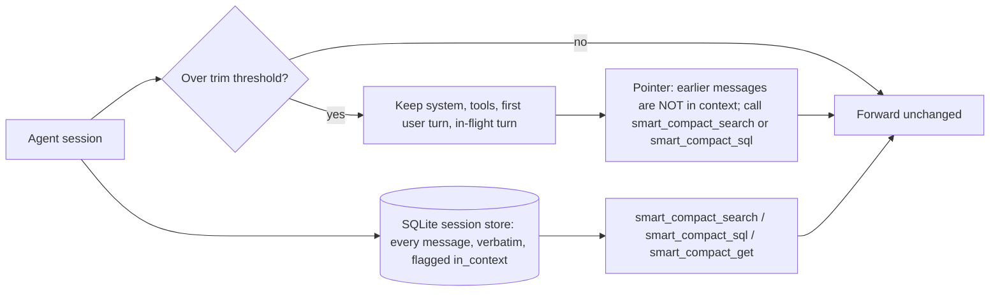

# Context research and evidence

Why the [context proxy](context-proxy.md) trims the way it does, which published work shaped it, and what our own benchmark runs show. Results are interim, dated 2026-10-29; runs B and C were still in progress.

## Problem

Long agent sessions outgrow the context window. Agents handle this in one of three ways, and each fails differently:

| Approach | Failure |
| --- | --- |
| Keep everything | The prompt grows until the window fills, and accuracy drops as input grows ("context rot", below). In our runs a kv-store session reached 979k tokens and never answered. |
| Native auto-compaction (LLM summary) | The summary keeps the gist but drops exact values. In our strict run it scored 0.049. |
| Trim + pointer + search (this proxy) | The agent must remember to search. Before the standing instruction, 2 of 12 trials never searched. |

## Related work

| Work | Approach | What we took | How we differ |
| --- | --- | --- | --- |
| [MemGPT](https://arxiv.org/abs/2310.08560) (Packer et al., 2023) | OS-style virtual context: a small main context plus searchable recall storage, paged in by function calls. | Verbatim recall storage behind search tools instead of a summary. | No self-editing memory; the proxy trims and the agent only searches. |
| [MemGPT DMR](https://arxiv.org/abs/2310.08560) (Table 2) and [MSC-Self-Instruct](https://huggingface.co/datasets/MemGPT/MSC-Self-Instruct) | Deep memory retrieval questions over earlier Multi-Session Chat sessions. GPT-4 scored 32.1% fixed-context and 92.5% with MemGPT; GPT-4 Turbo scored 35.3% and 93.4%. | Evidence that search over stored turns beats a fixed window. | Its conversations fit in today's windows, so it doesn't force trimming. Not run here. |
| MemGPT nested key-value retrieval (same paper) | Multi-hop lookups across key-value pairs. Fixed-context GPT-4 and GPT-4 Turbo reach 0% by 3 nesting levels; MemGPT with GPT-4 is unaffected by nesting depth. | Closest published analogue to our kv-store task. | Not run here. |
| [Letta: Is a Filesystem All You Need?](https://www.letta.com/blog/benchmarking-ai-agent-memory/) (2025-08-12) | Conversation history stored as files; agent uses `grep`, `search_files`, `open`, `close`. 74.0% on LoCoMo with GPT-4o mini, against 68.5% for Mem0's best graph variant. | File-like tools (search, open) work well; models already use them iteratively. | Letta's files are server-side and reached through tools. We copy that: the store is reached through MCP tools, not a shell. |
| [Mainplane](https://github.com/mainplane-ai/mainplane) | Each session is one append-only state file. `/continue` starts a new session with "You are continuing session X. Retrieve key context from it as you go." A standing "Context Management" system-prompt section says the previous session's log "is searchable with rg". | The pointer-and-retrieve continuation, and a standing system instruction telling the agent the content exists and how to fetch it. | We trim in place, keeping the same session and prompt-cache prefix, instead of starting a new session. Access is through tools, not `rg`. |
| [rtk](https://github.com/rtk-ai/rtk) | "CLI proxy that reduces LLM token consumption by 60-90% on common dev commands"; an optional `rtk-proxy` compresses provider-API payloads. | Compress large tool output before the model reads it; `install-coding-agent` runs `rtk init` when rtk is installed. | Our compression keeps the full text as a blob behind `smart_compact_get`, so nothing is lost. |
| [Anthropic: Effective context engineering](https://www.anthropic.com/engineering/effective-context-engineering-for-ai-agents) (2025-09-29) | "Just in time" retrieval: agents "maintain lightweight identifiers (file paths, stored queries, web links, etc.)" and load data with tools; compaction; structured note-taking. | The pointer is a lightweight identifier; the store is loaded just in time. | Anthropic's compaction writes a summary; ours stores the removed turns verbatim. |
| [Anthropic context editing and memory tool](https://claude.com/blog/context-management) (2025-09-29) | Server-side clearing of stale tool results, plus a client-side memory directory. Internal agentic-search eval: context editing +29%, with the memory tool +39%; 84% fewer tokens in a 100-turn web-search eval. | Clearing old content without a summary helps; saving it first helps more. | We work through any provider via LiteLLM, and the removed content stays searchable. |
| [Manus: Context engineering](https://agentic-ai.readthedocs.io/en/latest/ContextEngineering/manus/) | The file system as "the ultimate context"; every compression is "restorable" because the path or URL stays. | Restorable compression: every trimmed block and compressed result keeps an id the agent can fetch. | Same principle, applied in a proxy rather than in the agent. |
| [Chroma: Context Rot](https://www.trychroma.com/research/context-rot) (2025-07-14) and [repo](https://github.com/chroma-core/context-rot) | 18 models (GPT-4.1, Claude 4, Gemini 2.5, Qwen3). Accuracy falls as input grows, more for semantic than lexical needle matches. On LongMemEval, a ~300-token focused prompt beat a ~113k-token full prompt. | The goal: keep the active context small. Exact-match search plays to what models still do well. | Its tests are single prompts, not agent sessions. |
| [LongMemEval](https://arxiv.org/abs/2410.10813) | 500 questions over chat histories of ~115k tokens (S) or ~1.5M tokens (M); five memory abilities. | Candidate benchmark for paraphrase and semantic recall. | Not run yet. |
| [LoCoMo](https://arxiv.org/abs/2402.17753) ([data](https://github.com/snap-research/locomo)) | 50 dialogues, ~300 turns and ~9k tokens each, up to 35 sessions. | Used by Letta's result above. | Too short to force trimming. |
| [ContextBench](https://github.com/RulinShao/ContextBench) (from [Context Language Models](https://github.com/facebookresearch/context-language-models)) | Measures what an agent keeps, updates and offloads when input exceeds its window. Families: kv-store, log-triage, needle-retention, sudoku-sketchpad. Graded from the agent's own messages, not disk. Runs on Harbor. | Our benchmark harness and tasks. | We add a strict mode (below). |
| [Hindsight](https://github.com/vectorize-io/hindsight) | OpenMem's reference memory provider. | Recall on trim and, in run C, semantic search. | Provider recall alone (run C's s3d smoke test) found nearby keys rather than exact ones. |

## Design decisions and their evidence

| Decision | Evidence |
| --- | --- |
| Store removed turns verbatim and point to them instead of summarizing | Native summary scored 0.049 in the strict run against 0.750 for smart compaction; MemGPT and Letta show search over stored turns works. |
| Standing system instruction plus a firmer pointer ("NOT in your context. You MUST call smart_compact_search…") | Mainplane's pattern. Trials with zero searches fell from 2 of 12 (strict) to 0 of 12 (run A). |
| Pin the first user turn | Without it, a trim dropped the task statement itself. |
| Sticky, fingerprinted cut | Later requests get the same bytes, so the prompt cache keeps hitting after a trim. Smart compaction cost $0.84 per trial in the strict run against $1.46 for keep-everything; that gap mixes cache hits with smaller prompts. |
| Calibrate the token estimate from provider-reported usage | chars/4 underestimated these streams (about 2.3 characters per token), so a 120k threshold fired at 203–236k real tokens. Built: each thread's reported usage calibrates the estimate, with `chars_per_token` (2.5) before the first report ([token estimate](context-proxy.md#token-estimate)). Not yet benchmarked. |
| SQLite store: messages, lines, FTS5, hybrid ranking, read-only SQL tool | Built ([context store](context-store.md#session-database)); not yet benchmarked. Letta shows file-like tools work, but shell-only access limits retrieval to coding agents; MCP tools reach any agent. `sessions/<sid>.db` holds every message, in context or trimmed; `smart_compact_search` filters by `role` and `in_context`, and `smart_compact_sql` answers counts and aggregates. Its `lines` table gives exact counts, which the old log-based `line_matches` could not. |
| Semantic search through the memory provider | Being measured in run C (s3c-semantic-nudged, s3d-recall). |

## Benchmark method

| Item | Setting |
| --- | --- |
| Harness | Harbor running ContextBench tasks through Claude Code (2.1.312) in headless mode |
| Model | Claude Haiku 5.5 through LiteLLM v1.106.6 |
| Tasks | `kv-store` (stream SET batches, then GETs) and `log-triage` (log batches, then lookup and count questions); sizes R1000/R4000/R16000 and L1600/L6400/L12800 |
| Strict mode | Bash and file tools disabled. The first pilot scored 1.0 on every arm because the agent wrote values to a file in `/tmp` and grepped them back, so it measured the disk, not the context. |
| Settings (arms) | `s1-none` keep everything; `s2-native` Claude Code auto-compaction; `s3a-smart` proxy trim + search tools; `s3b-smart-nocomp` the same without tool-result compression; run C adds `s3c-semantic-nudged` and `s3d-recall` |
| Proxy settings | trim at 120,000 estimated tokens, compress tool results over 4,000 |
| Scoring | `reward` is ContextBench's score. kv answers must include a random `#hex` tag that Haiku often drops; `reward_lenient` also accepts an otherwise-correct answer without the tag. A trial that dropped the tag was rerun once. |
| Concurrency | 8 trials at once in the strict run, at most 4 in runs A–C |

## Results (interim, 2026-10-29)

### Strict run (complete; 24 trials, kv-store-R4000 and log-triage-L6400, seeds 42–44)

| Setting | reward | reward_lenient | $ per trial | Peak prompt | Native compactions | Trims | Searches per trial |
| --- | --- | --- | --- | --- | --- | --- | --- |
| s1 keep everything | 0.562 | 0.729 | 1.46 | 371k | 0 | 0 | — |
| s2 native | 0.049 | 0.049 | 0.47 | 121k | 3.7 | 0 | — |
| s3a smart | 0.750 | 0.750 | 0.84 | 214k | 0 | 1.5 | 12.7 |
| s3b smart, no compression | 0.611 | 0.611 | 0.85 | 220k | 0 | 1.0 | 7.3 |

No tool result crossed the 4,000-token threshold, so compression never ran and s3a and s3b were the same configuration; their gap is run-to-run variance. The count half of log-triage scored 0 in every setting.

### Run A: standing instruction and `line_matches` (first attempts complete; two tag-drop reruns pending)

Same tasks and seeds as the strict run, s3a and s3b only.

| Metric (s3a + s3b, 12 trials) | Strict run | Run A |
| --- | --- | --- |
| Trials with zero searches | 2 | **0** |
| kv-store reward_lenient, mean | 0.91 | **1.00** |
| log-triage lookup, mean | 0.90 | **1.00** |
| log-triage count, mean | 0 | 0.07 |
| log-triage reward, mean | 0.45 | **0.53** |

Run A used the earlier JSONL handoff log. Its `line_matches` counted only rows already trimmed into the log, so counts missed lines still in context (348 returned against a true 594), shifted between trims (111, then 184, against 171) and sometimes overcounted. The SQLite store replaces that log: `line_matches` now counts the `lines` table across the whole session, and `smart_compact_sql` answers counts directly. Neither has been benchmarked yet.

### Run B: score against size (partial; seed 42 only)

| Task, size | s1 keep everything | s2 native | s3a smart |
| --- | --- | --- | --- |
| kv R1000 | 1.00 (96k) | 1.00 (97k) | 1.00 (98k) |
| kv R4000 | 1.00 (358k) | 0.04 (120k) | 1.00 (204k) |
| kv R16000 | 0.00, hit step limit at 979k | pending | pending |
| log L1600 | 0.71 (lookup 1.00, count 0.42; 178k) | 0.50 (lookup 1.00, count 0; 120k) | 0.50 (lookup 1.00, count 0; 157k, no trim) |
| log L6400 | 0.42 (lookup 0.83, count 0; 386k) | 0.13 (lookup 0.25; 121k) | **0.63** (lookup 0.92, count 0.33; 234k) |

Peak prompt tokens in parentheses. Keep-everything loses lookups and counts as the log grows (context rot); smart compaction holds lookups with a prompt about 40% smaller.

## Limitations

- One model (Haiku 5.5) and three seeds per task.
- Synthetic tasks with exact keys, which favour lexical search. No paraphrase or semantic task yet.
- Haiku drops the `#tag` in kv answers in every setting; compare `reward_lenient`.
- The trim fired late (203–236k real tokens) because of the chars/4 estimate, since replaced by the calibrated estimate.
- kv R16000 under s1 hit the harness step limit at 979k tokens before any question, so it is not a recall score.
- Count scores are limited by the JSONL log's `line_matches`, not by whether the agent searches.
- Compression never fired, so s3a and s3b test the same thing.

## Next steps

1. Finish runs B and C (semantic search through the provider).
2. Rerun s3a on the SQLite store with the calibrated token estimate.
3. Add a paraphrase task: Chroma's semantic needle variant or LongMemEval.
4. Repeat with a second model.
